# Kubernetes Lab on Windows

## 1. Experiment Name
Setup and Deployment of a Three-Node Kubernetes Cluster Using Kind on Windows.

## 2. Problem Statement
To set up a Kubernetes environment on Windows using WSL2, Docker Desktop, kubectl, and Kind, and understand container orchestration through deployment, scaling, and self-healing.

## 3. Objectives
- Install and configure WSL2, Docker Desktop, kubectl, and Kind.
- Create a Kubernetes cluster with one control-plane node and two worker nodes.
- Deploy an NGINX application.
- Scale the deployment from 3 to 6 replicas.
- Understand Kubernetes self-healing by deleting a Pod and observing its replacement.

## 4. Software Requirements
- Windows OS
- WSL2
- Docker Desktop
- kubectl
- Kind
- PowerShell
- NGINX container image

## 5. Cluster Architecture

```text
             Kubernetes Cluster
                      |
             Control Plane Node
                      |
          -------------------------
          |                       |
      Worker Node 1           Worker Node 2
          |                       |
       NGINX Pods              NGINX Pods
```

## 6. Configuration
The `kind-config.yaml` file defines one control-plane node and two worker nodes.

## 7. Implementation

### Step 1: Install Required Tools
Installed and configured WSL2, Docker Desktop, kubectl, and Kind.

### Step 2: Verify Installation
Verified the installed tools using version commands and tested Docker using the hello-world image.

### Step 3: Create Cluster Configuration
Created `kind-config.yaml` to define the three-node Kubernetes cluster.

### Step 4: Create Kubernetes Cluster
Created the cluster using Kind and verified the nodes and system Pods.

### Step 5: Deploy NGINX Application
Created an NGINX Deployment with 3 replicas and verified the running Pods. Also created a NodePort service and accessed the NGINX welcome page through the browser using port forwarding.

### Step 6: Scaling and Self-Healing
- Scaled the NGINX Deployment from 3 to 6 replicas.
- Deleted one running Pod manually.
- Kubernetes automatically created a replacement Pod.
- Verified that all 6 Pods returned to the Running state.

## 8. Results
- Successfully created a three-node Kubernetes cluster.
- Successfully deployed the NGINX application.
- Scaled the application to 6 replicas.
- Verified automatic Pod replacement through Kubernetes self-healing.
- Accessed the NGINX welcome page through the browser.

## 9. Screenshots

### 9.1 Installation and Tool Verification

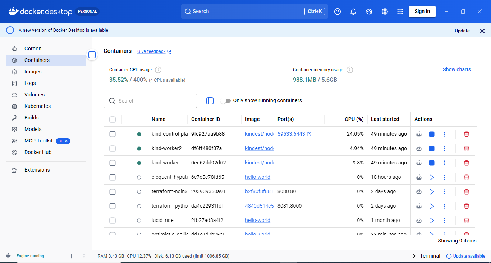

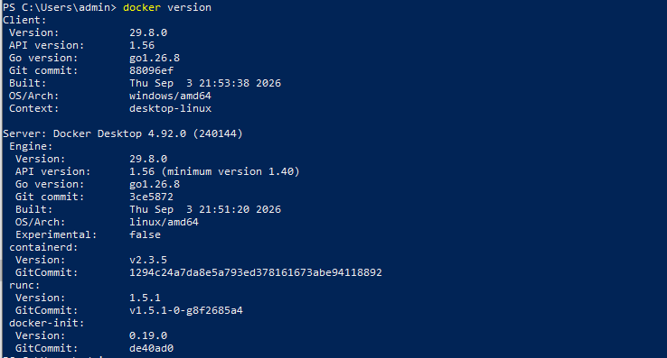


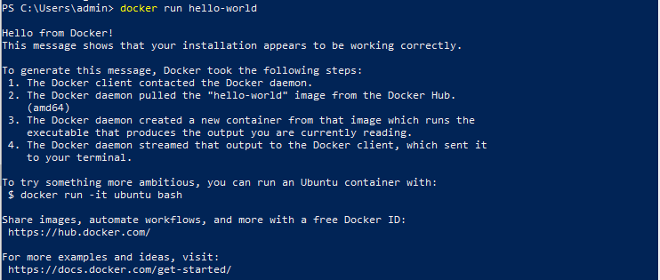

### 9.2 Cluster Configuration and Creation

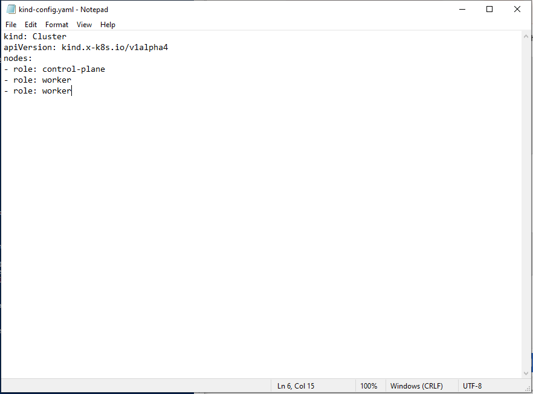

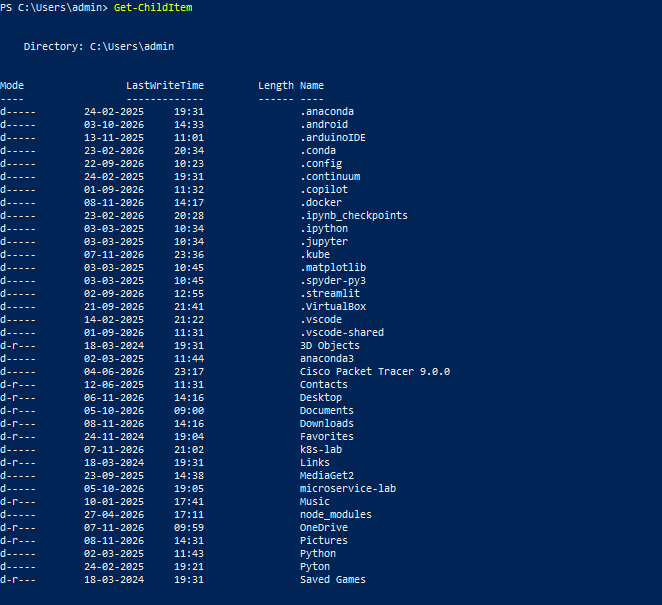

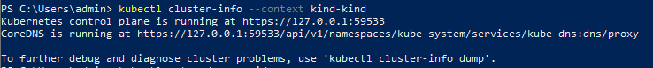

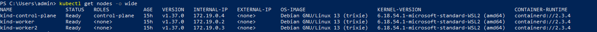


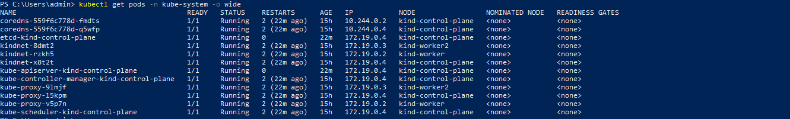

### 9.3 NGINX Deployment


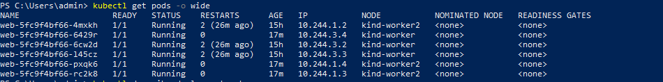

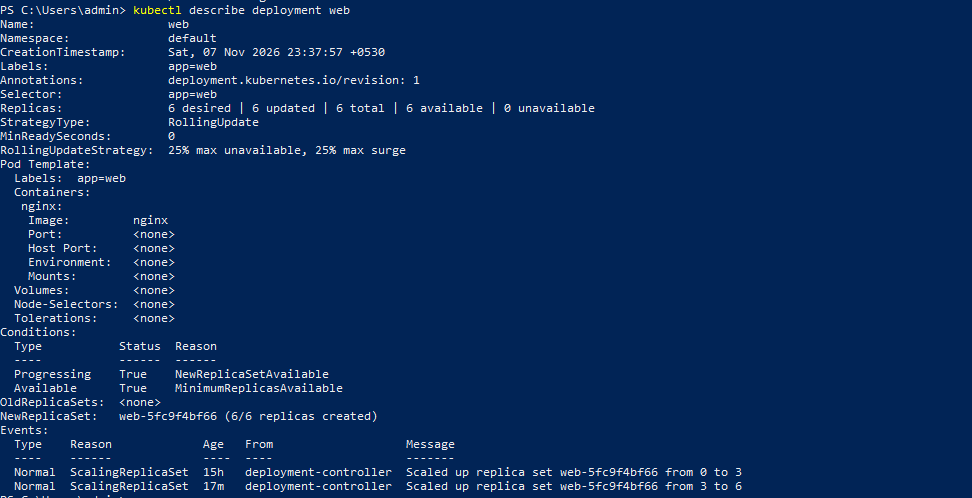


### 9.4 Scaling and Self-Healing

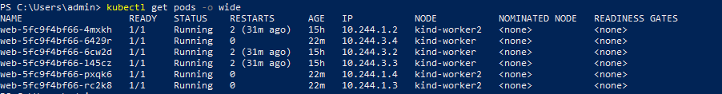


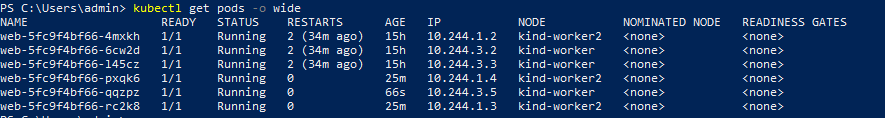

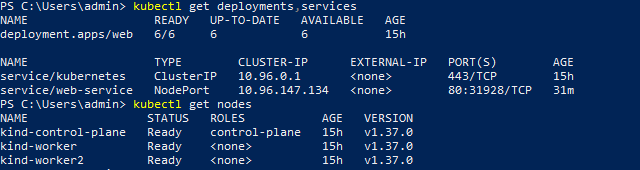

## 10. Conclusion
Successfully configured a Kubernetes cluster on Windows using Kind. Deployed an NGINX application, performed scaling, and verified Kubernetes self-healing. This experiment demonstrated the basic concepts of container orchestration and workload management.
