# ☸️ CC Experiment – Kubernetes Health Checks

## 📑 Table of Contents
1. Problem Statement
2. Objectives
3. Technologies Used
4. System Architecture
5. Application Implementation
   - 5.1 Application Endpoints
   - 5.2 Docker Configuration
6. Kubernetes Configuration
   - 6.1 Deployment Configuration
   - 6.2 Service Configuration
   - 6.3 Health Probe Configuration
7. Execution Steps
8. Testing and Results
   - 8.1 Pod Status
   - 8.2 Liveness Probe Testing
   - 8.3 Readiness Probe Testing
   - 8.4 Screenshots and Experimental Evidence
9. Liveness vs Readiness Comparison
10. Results and Observations
11. Conclusion
12. Author

## 1. Problem Statement

In containerized applications, it is important to continuously monitor application health and availability. An application may experience failures or may temporarily become unavailable while its container is still running.

Kubernetes provides Liveness Probes and Readiness Probes to monitor the health of containers and manage application traffic.

This experiment implements a Node.js application with health-check endpoints and deploys it on Kubernetes using Minikube.

The experiment demonstrates how Kubernetes detects application failures, restarts unhealthy containers, and controls traffic to application Pods based on their readiness status.

## 2. Objectives

- To understand Kubernetes health checks.
- To understand the difference between liveness and readiness probes.
- To develop a Node.js application using Express.
- To create a Docker image for the application.
- To deploy the application using Kubernetes.
- To configure liveness and readiness probes in a Deployment.
- To expose the application using a NodePort Service.
- To simulate application failures and recovery.
- To observe container restart behavior during liveness failure.
- To understand how readiness failure affects service traffic.

## 3. Technologies Used

| Technology | Purpose |
|---|---|
| Node.js | Application runtime |
| Express.js | Web application framework |
| Docker | Containerization |
| Kubernetes | Container orchestration |
| Minikube | Local Kubernetes cluster |
| YAML | Kubernetes configuration |
| kubectl | Kubernetes command-line tool |

## 4. System Architecture

The application is deployed inside a Kubernetes cluster using Docker containers.

### Architecture Diagram

```text
             User / Browser
                    |
                    |
             NodePort Service
                Port 30080
                    |
                    |
          Kubernetes Cluster
                    |
             Deployment
                    |
              2 Replicas
               /      \
              /        \
          Pod 1        Pod 2
            |            |
        Container    Container
            |            |
        Node.js      Node.js
        Express      Express
            |            |
       Port 3000     Port 3000
            |            |
       Health Probes  Health Probes
            |            |
       Liveness & Readiness
```

### Architecture Description

- The user accesses the application through the NodePort Service.
- The Kubernetes Service forwards traffic to available healthy and ready Pods.
- The Deployment maintains two application replicas.
- Each Pod runs the Node.js application inside a container.
- The liveness probe checks whether the application is alive.
- The readiness probe checks whether the application is ready to receive traffic.
- Kubernetes takes appropriate action based on the probe results.

## 5. Application Implementation

The application is developed using Node.js and Express.js.

The Express application runs on port 3000 and provides different endpoints to simulate normal operation, application failure, and recovery.

### 5.1 Application Endpoints

| Endpoint | Description |
|---|---|
| `/live` | Checks whether the application is alive |
| `/ready` | Checks whether the application is ready to receive traffic |
| `/fail-live` | Simulates a liveness failure |
| `/not-ready` | Simulates a readiness failure |
| `/recover` | Restores the application health states |

### Endpoint Description

**1. `/live`**

Returns a successful response when the application is alive. Kubernetes uses this endpoint for the liveness probe.

**2. `/ready`**

Returns a successful response when the application is ready to handle incoming requests. Kubernetes uses this endpoint for the readiness probe.

**3. `/fail-live`**

Simulates an application liveness failure. The liveness probe detects the failure, and Kubernetes restarts the affected container.

**4. `/not-ready`**

Simulates a readiness failure. Kubernetes marks the Pod as not ready and removes it from the Service's available endpoints.

**5. `/recover`**

Restores the application's health states so that it can become healthy and ready again.

### 5.2 Docker Configuration

A Dockerfile is created to containerize the Node.js application.

The Docker image uses Node.js 20 Alpine as its base image.

The Dockerfile performs the following operations:

- Selects the Node.js 20 Alpine base image.
- Sets the application working directory.
- Copies the package files.
- Installs application dependencies.
- Copies the application source code.
- Exposes port 3000.
- Starts the Node.js application.

## 6. Kubernetes Configuration

Kubernetes configuration is defined using YAML files.

The project contains two main Kubernetes configuration files:

- `deployment.yaml`
- `service.yaml`

### 6.1 Deployment Configuration

The Deployment manages the application Pods and maintains the desired number of replicas.

| Parameter | Configuration |
|---|---|
| Resource | Deployment |
| Application | Health App |
| Replicas | 2 |
| Container Port | 3000 |
| Liveness Probe | `/live` |
| Readiness Probe | `/ready` |

**Deployment Responsibilities**

- Creates and manages two application Pods.
- Ensures the required number of replicas are running.
- Monitors container health using probes.
- Restarts containers when liveness checks continuously fail.
- Maintains application availability through replica management.

### 6.2 Service Configuration

A NodePort Service is used to expose the application outside the Kubernetes cluster.

| Parameter | Configuration |
|---|---|
| Resource | Service |
| Service Type | NodePort |
| Service Port | 3000 |
| Target Port | 3000 |
| NodePort | 30080 |

The Service provides a stable way to access the application and forwards requests to available ready Pods.

### 6.3 Health Probe Configuration

**A. Liveness Probe**

The liveness probe determines whether the application is functioning correctly.

- Uses the `/live` endpoint.
- Checks the health of the application.
- If the probe continuously fails, Kubernetes restarts the affected container.
- Helps recover from application failures.

**B. Readiness Probe**

The readiness probe determines whether the application can receive traffic.

- Uses the `/ready` endpoint.
- Checks application availability.
- If the probe fails, the Pod is marked as not ready.
- The Pod is removed from the Service's available endpoints.
- The container is not restarted just because readiness fails.

## 7. Execution Steps

**Step 1: Start Minikube**

Start the local Kubernetes cluster using Docker as the driver.

```bash
minikube start --driver=docker
```

**Step 2: Verify Minikube Status**

```bash
minikube status
```

**Step 3: Build the Docker Image**

Build the application image using the Dockerfile.

```bash
docker build -t health-app .
```

If using a Minikube-local image, build or load the image into Minikube according to the image configuration in deployment.yaml.

**Step 4: Deploy the Application**

Apply the Kubernetes Deployment configuration.

```bash
kubectl apply -f deployment.yaml
```

**Step 5: Create the Service**

Apply the Service configuration.

```bash
kubectl apply -f service.yaml
```

**Step 6: Verify Pods**

```bash
kubectl get pods
```

**Step 7: Verify Services**

```bash
kubectl get services
```

**Step 8: Check Deployment**

```bash
kubectl get deployments
```

**Step 9: Access the Application**

```bash
minikube service health-service
```

The application is exposed through the NodePort Service on port 30080.

## 8. Testing and Results

The application is tested by simulating liveness and readiness failures.

### 8.1 Pod Status

The following command is used to check the application Pods.

```bash
kubectl get pods
```

The Pods are expected to reach the Running state and show 1/1 in the READY column when healthy.

### 8.2 Liveness Probe Testing

**Objective:** To verify whether Kubernetes restarts a container when the application becomes unhealthy.

**Execution:**

- Access the `/fail-live` endpoint.
- The application simulates a liveness failure.
- Kubernetes detects the failure through the liveness probe.
- The affected container is restarted.
- Check the restart count using:

```bash
kubectl get pods
```

**Observation:**

The liveness probe detects the failure and Kubernetes restarts the affected container. The restart count increases.

### 8.3 Readiness Probe Testing

**Objective:** To verify whether Kubernetes stops sending traffic to a Pod that is not ready.

**Execution:**

- Access the `/not-ready` endpoint.
- The application simulates a readiness failure.
- The readiness probe detects the failure.
- Kubernetes marks the Pod as not ready.
- Check the Pod status:

```bash
kubectl get pods
```

- Check the Service endpoints:

```bash
kubectl get endpoints health-service
```

**Observation:**

The affected Pod is marked as not ready and is removed from the Service's available endpoints. The container is not restarted due to the readiness failure.

### 8.4 Screenshots and Experimental Evidence

The following screenshots show the actual execution and results of the Kubernetes Health Checks experiment.

**A. Kubernetes Environment and Deployment**

**1. Minikube Status**

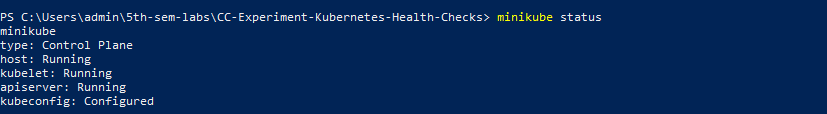

**2. Deployment Configuration**

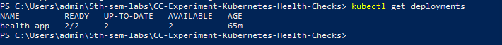

**3. Service Running**

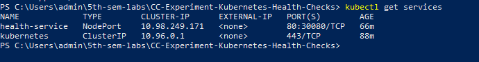

**4. Liveness and Readiness Probe Configuration**

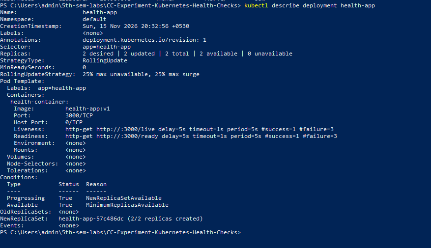

**B. Kubernetes Events**

**5. Pod Events**

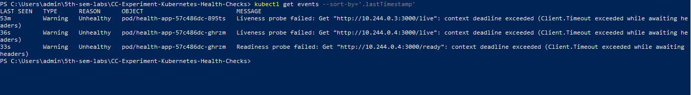

**C. Successful Health Checks**

**6. Liveness Test**

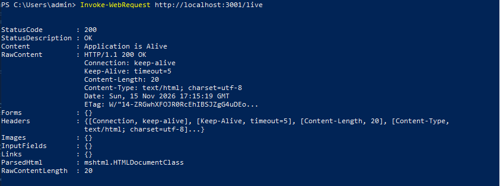

**7. Readiness Test**

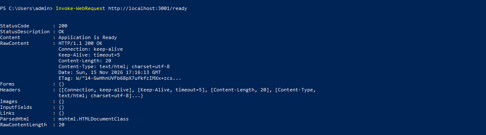

**D. Failure Simulation**

**8. Liveness Failure Simulation**

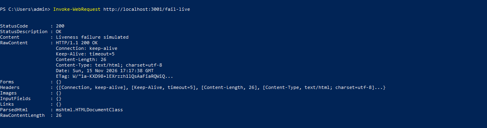

**9. Liveness Probe Failed**

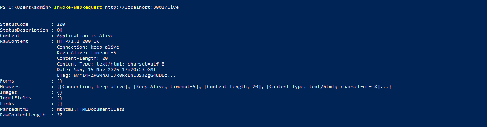

**10. Readiness Failure Simulation**

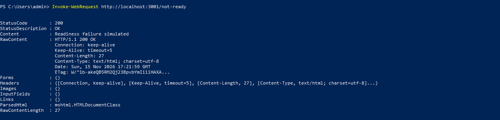

**11. Readiness Probe Failed**

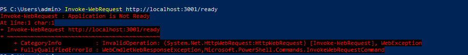

**E. Recovery and Final Verification**

**12. Recovery Test**

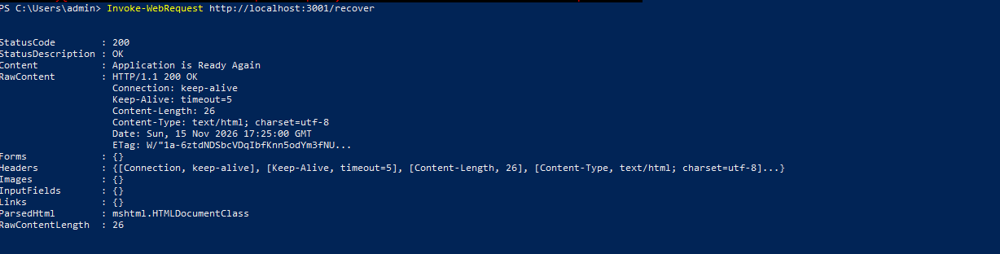

**13. Final Pod Status**

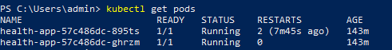

## 9. Liveness vs Readiness Comparison

| Feature | Liveness Probe | Readiness Probe |
|---|---|---|
| Purpose | Checks whether the application is alive | Checks whether the application can receive traffic |
| Endpoint | `/live` | `/ready` |
| On Failure | Restarts the container after configured failure threshold | Marks the Pod as not ready |
| Traffic Handling | Does not directly control Service traffic | Removes the Pod from available Service endpoints |
| Container Restart | Yes, after repeated probe failures | No, not due to readiness failure |
| Main Benefit | Recovers from application failures | Prevents traffic from reaching unavailable applications |

## 10. Results and Observations

The Kubernetes Health Checks experiment was successfully implemented and tested using Minikube.

The following observations were obtained:

| Test Case | Expected Behavior | Observed Result |
|---|---|---|
| Normal application | Pod remains healthy | Successful |
| Liveness failure | Container restarts | Successful |
| Readiness failure | Pod removed from Service endpoints | Successful |
| Recovery | Application becomes healthy and ready again | Supported by recovery endpoint |

**Key Observations**

- Kubernetes continuously monitors the application using health probes.
- Liveness probes help Kubernetes detect and recover from application failures.
- Readiness probes control whether a Pod receives application traffic.
- A liveness failure causes the affected container to restart after the configured failure threshold.
- A readiness failure does not restart the container.
- The Service forwards traffic only to available ready Pods.

## 11. Conclusion

This experiment demonstrates the implementation and working of Kubernetes Liveness and Readiness Probes using a Node.js application.

The application was containerized using Docker and deployed on a local Kubernetes cluster using Minikube.

The liveness probe was used to detect application failures and restart unhealthy containers. The readiness probe was used to determine whether application Pods were ready to receive traffic.

The failure scenarios were successfully tested, demonstrating that Kubernetes handles application recovery and traffic management using these two probes.

Thus, the experiment provides practical understanding of Kubernetes health monitoring, container lifecycle management, and application availability.

## 12. Author

**Krupa Akki**

CSE (Artificial Intelligence)

K.L.E. Technological University