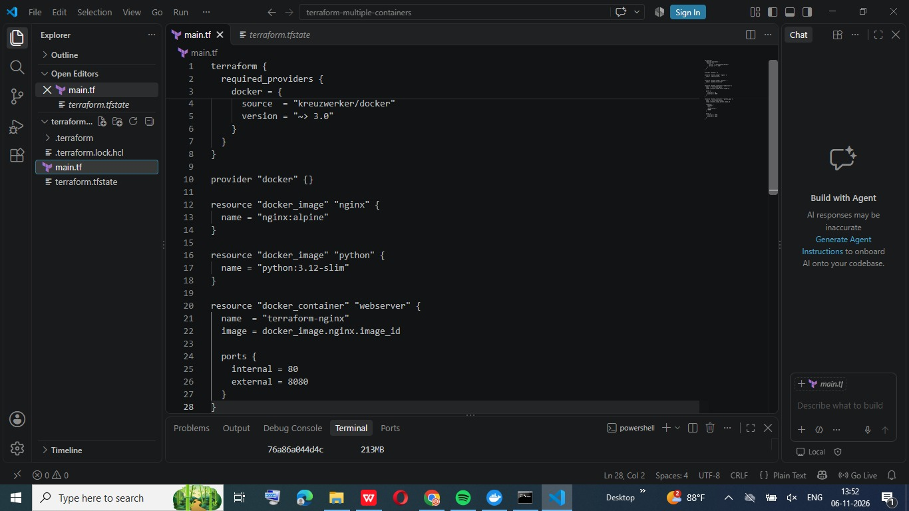
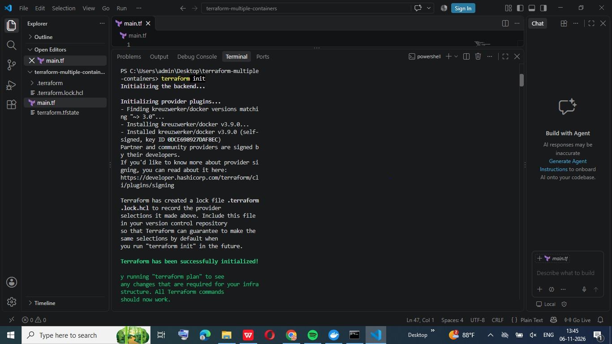
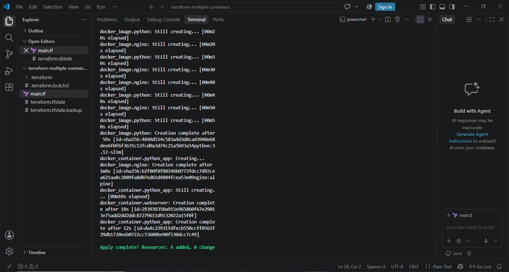
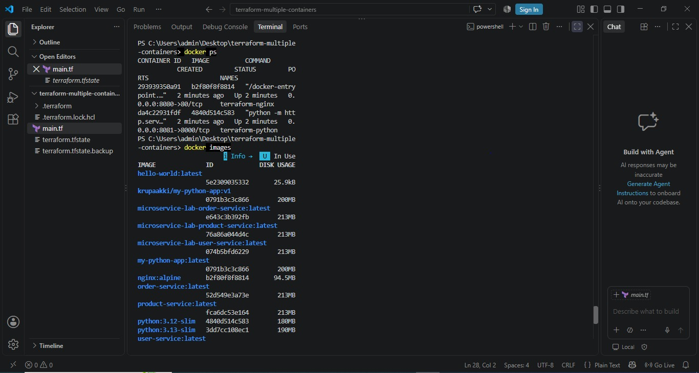
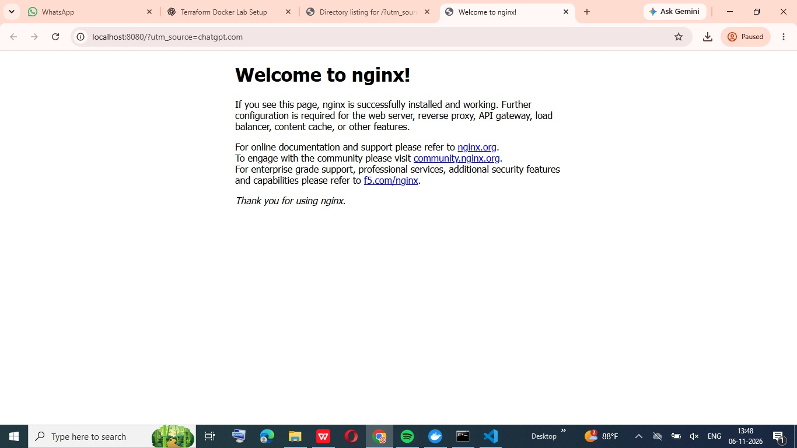
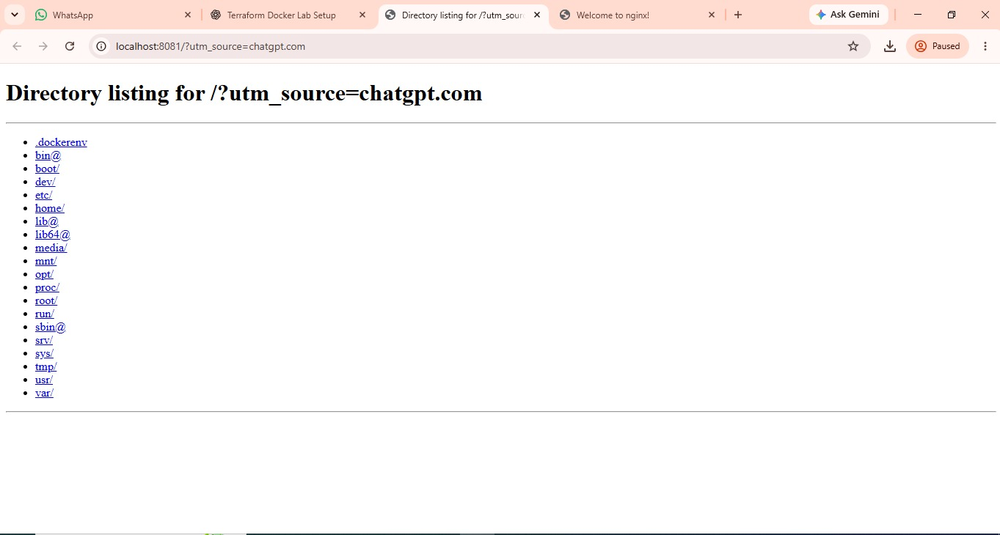

# CC Experiment: Deploying Multiple Docker Containers Using Terraform

## 📑 Table of Contents

- [1. Problem Statement](#1-problem-statement)
- [2. Objectives](#2-objectives)
- [3. Tools and Technologies Used](#3-tools-and-technologies-used)
- [4. Terraform Configuration](#4-terraform-configuration)
  - [4.1 Nginx Container](#41-nginx-container)
  - [4.2 Python Container](#42-python-container)
- [5. Execution Steps](#5-execution-steps)
  - [5.1 Terraform Initialization](#51-terraform-initialization)
  - [5.2 Terraform Validation](#52-terraform-validation)
  - [5.3 Terraform Plan](#53-terraform-plan)
  - [5.4 Terraform Apply](#54-terraform-apply)
- [6. Docker Container Verification](#6-docker-container-verification)
- [7. Browser Verification](#7-browser-verification)
  - [7.1 Nginx Web Server](#71-nginx-web-server)
  - [7.2 Python HTTP Server](#72-python-http-server)
- [8. Results and Conclusion](#8-results-and-conclusion)
  - [8.1 Execution Results](#81-execution-results)
  - [8.2 Result Screenshots](#82-result-screenshots)
  - [8.3 Conclusion](#83-conclusion)
- [9. Author](#9-author)

---

## 1. Problem Statement

To deploy and manage multiple Docker containers using Terraform as an Infrastructure as Code (IaC) tool. The experiment involves creating and running an Nginx web server container and a Python HTTP server container using Terraform configuration files.

## 2. Objectives

- To understand Infrastructure as Code (IaC) using Terraform.
- To configure and deploy multiple Docker containers.
- To automate container creation and management.
- To run an Nginx web server and a Python HTTP server.
- To verify the running containers using Docker commands and a web browser.

## 3. Tools and Technologies Used

- **Terraform:** Infrastructure as Code tool.
- **Docker:** Containerization platform.
- **Nginx:** Web server.
- **Python:** HTTP server.
- **Operating System:** Windows.
- **Browser:** To verify the deployed web servers.

## 4. Terraform Configuration

### 4.1 Nginx Container

- Docker Image: `nginx:alpine`
- Container Name: `terraform-nginx`
- Host Port: `8080`
- Container Port: `80`

The Nginx container is configured to run a web server accessible through port 8080.

### 4.2 Python Container

- Docker Image: `python:3.12-slim`
- Container Name: `terraform-python`
- Host Port: `8081`
- Container Port: `8000`

The Python container runs a simple HTTP server using:

`python -m http.server 8000`

## 5. Execution Steps

### 5.1 Terraform Initialization

Command:

`terraform init`

Initializes the Terraform working directory and downloads the required provider plugins.

### 5.2 Terraform Validation

Command:

`terraform validate`

Checks whether the Terraform configuration is syntactically valid and internally consistent.

### 5.3 Terraform Plan

Command:

`terraform plan`

Displays the execution plan and shows the resources Terraform will create.

### 5.4 Terraform Apply

Command:

`terraform apply`

Creates and deploys the configured Docker containers.

## 6. Docker Container Verification

Command:

`docker ps`

This command displays the running Docker containers.

The following containers should be running:

| Container | Image | Port |
|---|---|---|
| terraform-nginx | nginx:alpine | 8080:80 |
| terraform-python | python:3.12-slim | 8081:8000 |

## 7. Browser Verification

### 7.1 Nginx Web Server

URL: http://localhost:8080

The Nginx welcome page is displayed, confirming that the Nginx container is running successfully.

### 7.2 Python HTTP Server

URL: http://localhost:8081

The Python HTTP server directory listing is displayed, confirming that the Python container is running successfully.

## 8. Results and Conclusion

### 8.1 Execution Results

- Terraform initialization completed successfully.
- Terraform validation completed successfully.
- Terraform plan was generated successfully.
- Terraform apply completed successfully.
- **4 resources added, 0 changed, 0 destroyed.**
- Both Docker containers were created and started successfully.
- Nginx and Python HTTP servers were accessible through their respective browser URLs.

### 8.2 Result Screenshots

**1. Terraform Configuration**

**2. Terraform Initialization**

**3. Terraform Apply Output**

**4. Docker Container Verification**

**5. Nginx Browser Output**

**6. Python Browser Output**

### 8.3 Conclusion

The experiment successfully demonstrated the deployment and management of multiple Docker containers using Terraform. Both Nginx and Python HTTP server containers were created and executed successfully. Their functionality was verified using Docker commands and web browsers. This experiment helped in understanding Infrastructure as Code and container automation.

## 9. Author

**Krupa Akki**  
K.L.E. Technological University, Hubli
