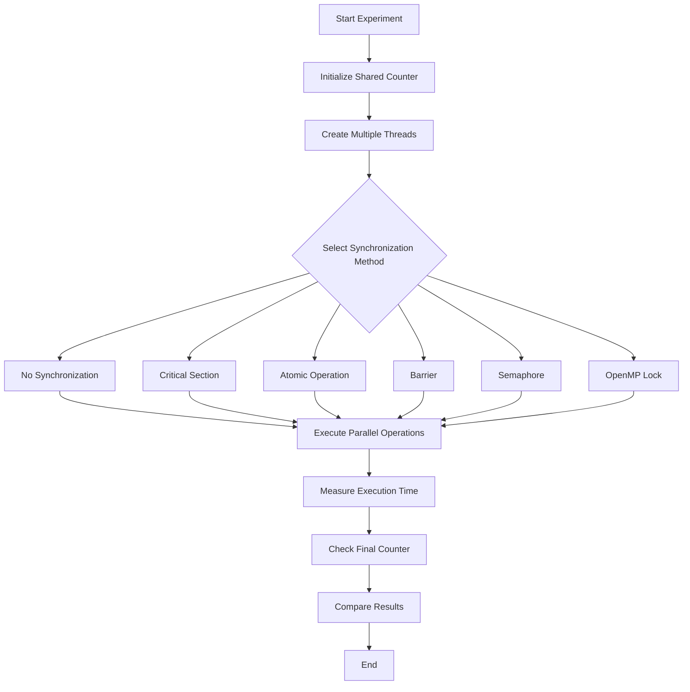
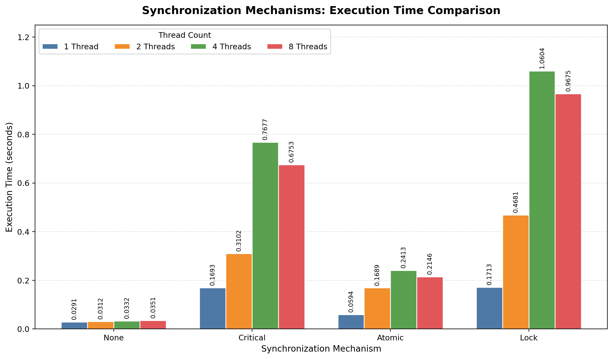
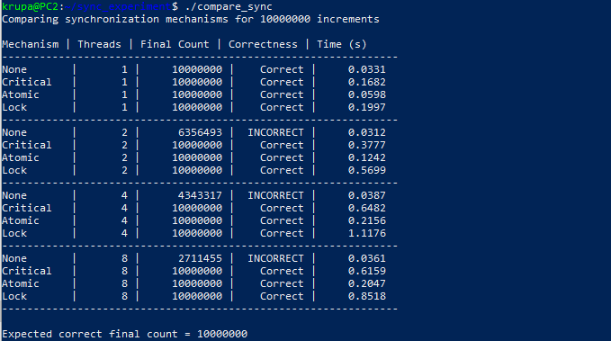

# PGC Experiment 3: Analyze Synchronization Mechanisms in Parallel Programs

A practical implementation and performance analysis of synchronization mechanisms in shared-memory parallel programming using **C, OpenMP, POSIX Threads, and Ubuntu on WSL**.

This experiment demonstrates race conditions, critical sections, atomic operations, barriers, semaphores, and locks. It also compares the execution time and correctness of different synchronization techniques using multiple threads.

---

## Table of Contents

1. [Project Overview](#1-project-overview)
2. [Problem Statement](#2-problem-statement)
3. [Objectives](#3-objectives)
4. [Technologies and Requirements](#4-technologies-and-requirements)
5. [Synchronization Concepts](#5-synchronization-concepts)
6. [System Architecture](#6-system-architecture)
7. [Implementation](#7-implementation)
   - [Race Condition](#71-race-condition)
   - [Critical Section](#72-critical-section)
   - [Atomic Operation](#73-atomic-operation)
   - [Barrier Synchronization](#74-barrier-synchronization)
   - [Semaphore Synchronization](#75-semaphore-synchronization)
   - [Performance Comparison](#76-performance-comparison)
8. [Compilation and Execution](#8-compilation-and-execution)
9. [Experimental Results](#9-experimental-results)
10. [Performance Analysis and Graph](#10-performance-analysis-and-graph)
11. [Screenshots](#11-screenshots)
12. [Conclusion](#12-conclusion)
13. [Repository Structure](#13-repository-structure)

---

## 1. Project Overview

Synchronization is an important concept in parallel programming. When multiple threads access and modify shared data simultaneously, incorrect results may occur due to race conditions.

This experiment implements different synchronization mechanisms and evaluates their correctness and performance.

Two threads or multiple OpenMP threads perform operations on shared variables. The results are compared to understand how synchronization protects shared resources.

## 2. Problem Statement

In a parallel program, multiple threads may attempt to update the same shared variable simultaneously. Without proper synchronization, some updates may be lost, resulting in incorrect output.

The experiment addresses this problem by implementing different synchronization techniques and comparing their execution time and correctness.

## 3. Objectives

- Understand race conditions in parallel programs.
- Implement critical sections using OpenMP.
- Implement atomic operations.
- Understand barrier synchronization.
- Implement semaphore-based synchronization using POSIX threads.
- Compare synchronization mechanisms with different thread counts.
- Analyze execution time and correctness.

## 4. Technologies and Requirements

| Component | Details |
|---|---|
| Programming Language | C |
| Parallel Programming | OpenMP |
| Thread Library | POSIX Threads |
| Synchronization | Critical, Atomic, Barrier, Semaphore, Lock |
| Operating System | Ubuntu on WSL |
| Compiler | GCC |
| Repository | GitHub |

## 5. Synchronization Concepts

### 5.1 Race Condition

A race condition occurs when multiple threads access and modify shared data simultaneously without proper synchronization.

This may cause lost updates and incorrect results.

### 5.2 Critical Section

A critical section allows only one thread at a time to execute a particular block of code.

OpenMP directive:

```c
#pragma omp critical
```

### 5.3 Atomic Operation

An atomic operation ensures that a particular memory update is performed as one indivisible operation.

OpenMP directive:

```c
#pragma omp atomic
```

### 5.4 Barrier Synchronization

A barrier ensures that all threads reach a particular point before any thread continues execution.

OpenMP directive:

```c
#pragma omp barrier
```

### 5.5 Semaphore

A semaphore controls access to a shared resource using a counter. A binary semaphore can be used to allow only one thread into a protected section at a time.

POSIX functions include:

```c
sem_init()
sem_wait()
sem_post()
sem_destroy()
```

### 5.6 Lock

A lock allows only one thread at a time to access a protected section of code.

OpenMP functions include:

```c
omp_init_lock()
omp_set_lock()
omp_unset_lock()
omp_destroy_lock()
```

## 6. System Architecture

The experiment follows this execution flow:



## 7. Implementation

The experiment contains six C programs.

### 7.1 Race Condition

**File:** `race.c`

This program increments a shared counter using multiple threads without synchronization.

```c
#include <stdio.h>
#include <omp.h>

int main() {
    long long counter = 0;

    #pragma omp parallel for
    for (long long i = 0; i < 10000000; i++) {
        counter++;
    }

    printf("Counter=%lld\n", counter);

    return 0;
}
```

**Expected observation:** The final counter may be less than 10,000,000 because multiple threads can overwrite each other's updates.

### 7.2 Critical Section

**File:** `critical.c`

This program uses an OpenMP critical section to protect the shared counter.

```c
#include <stdio.h>
#include <omp.h>

int main() {
    long long counter = 0;

    #pragma omp parallel for
    for (long long i = 0; i < 10000000; i++) {
        #pragma omp critical
        {
            counter++;
        }
    }

    printf("Counter=%lld\n", counter);

    return 0;
}
```

**Expected result:** 10,000,000.

### 7.3 Atomic Operation

**File:** `atomic.c`

This program uses the OpenMP atomic directive to perform thread-safe counter updates.

```c
#include <stdio.h>
#include <omp.h>

int main() {
    long long counter = 0;

    #pragma omp parallel for
    for (long long i = 0; i < 10000000; i++) {
        #pragma omp atomic
        counter++;
    }

    printf("Counter=%lld\n", counter);

    return 0;
}
```

**Expected result:** 10,000,000.

### 7.4 Barrier Synchronization

**File:** `barrier.c`

This program demonstrates how a barrier makes threads wait until all threads reach the synchronization point.

```c
#include <stdio.h>
#include <omp.h>

int main() {
    #pragma omp parallel num_threads(4)
    {
        int id = omp_get_thread_num();

        printf("Thread %d before barrier\n", id);

        #pragma omp barrier

        printf("Thread %d after barrier\n", id);
    }

    return 0;
}
```

**Expected observation:** All threads print their messages before the barrier, and only after every thread reaches it can they continue.

### 7.5 Semaphore Synchronization

**File:** `semaphore.c`

This program uses a POSIX binary semaphore to protect a shared counter accessed by two threads.

**Expected result:** 200,000.

### 7.6 Performance Comparison

**File:** `compare_sync.c`

This program compares four synchronization methods:

- None
- Critical
- Atomic
- OpenMP Lock

The experiment uses 1, 2, 4, and 8 threads and performs 10,000,000 increments for each test.

The program records:

- Number of threads
- Final counter value
- Correctness
- Execution time

## 8. Compilation and Execution

### Step 1: Navigate to the project directory

```bash
cd ~/sync_experiment
```

### Step 2: Compile all programs

```bash
gcc race.c -fopenmp -o race
gcc critical.c -fopenmp -o critical
gcc atomic.c -fopenmp -o atomic
gcc barrier.c -fopenmp -o barrier
gcc semaphore.c -pthread -o semaphore
gcc compare_sync.c -fopenmp -o compare_sync
```

### Step 3: Execute individual programs

```bash
OMP_NUM_THREADS=4 ./race
OMP_NUM_THREADS=4 ./critical
OMP_NUM_THREADS=4 ./atomic
OMP_NUM_THREADS=4 ./barrier
./semaphore
```

### Step 4: Execute performance comparison

```bash
./compare_sync
```

To save the comparison output:

```bash
./compare_sync | tee results.txt
```

## 9. Experimental Results

### 9.1 Individual Program Results

| Program | Observed Output | Result |
|---|---:|---|
| Race Condition | 4,325,508 | Incorrect |
| Critical Section | 10,000,000 | Correct |
| Atomic Operation | 10,000,000 | Correct |
| Barrier | All threads synchronized | Successful |
| Semaphore | 200,000 | Correct |

**Note:** The race condition output can vary between executions because the program intentionally uses an unsynchronized shared counter.

### 9.2 Performance Comparison Results

The following results were obtained during one execution of the comparison program.

| Mechanism | Threads | Final Count | Correctness | Time (s) |
|---|---:|---:|---|---:|
| None | 1 | 10,000,000 | Correct | 0.0291 |
| Critical | 1 | 10,000,000 | Correct | 0.1693 |
| Atomic | 1 | 10,000,000 | Correct | 0.0594 |
| Lock | 1 | 10,000,000 | Correct | 0.1713 |
| None | 2 | 6,316,021 | Incorrect | 0.0312 |
| Critical | 2 | 10,000,000 | Correct | 0.3102 |
| Atomic | 2 | 10,000,000 | Correct | 0.1689 |
| Lock | 2 | 10,000,000 | Correct | 0.4681 |
| None | 4 | 2,622,866 | Incorrect | 0.0332 |
| Critical | 4 | 10,000,000 | Correct | 0.7677 |
| Atomic | 4 | 10,000,000 | Correct | 0.2413 |
| Lock | 4 | 10,000,000 | Correct | 1.0604 |
| None | 8 | 1,631,471 | Incorrect | 0.0351 |
| Critical | 8 | 10,000,000 | Correct | 0.6753 |
| Atomic | 8 | 10,000,000 | Correct | 0.2146 |
| Lock | 8 | 10,000,000 | Correct | 0.9675 |

Expected correct final count: **10,000,000**.

## 10. Performance Analysis and Graph

### 10.1 Execution Time Comparison



### 10.2 Observations

1. The unsynchronized program is fast, but it produces incorrect results when multiple threads update the shared counter.
2. Critical sections provide correct results by allowing only one thread at a time to update the counter.
3. Atomic operations provide correct results and had the lowest measured execution time among the correct synchronization methods in the 2-, 4-, and 8-thread tests.
4. Locks also provide mutual exclusion, but their measured execution time was higher in this experiment.
5. Increasing the number of threads does not always improve performance because synchronization introduces overhead and contention.

**Note:** These are experimental measurements from one run, not universal performance guarantees. The unsynchronized program contains a data race, so its behavior and timing are not reliable benchmarks.

## 11. Result Screenshots

### Synchronization Program Outputs


### Performance Comparison



### Successful Compilation


## 12. Conclusion

This experiment demonstrated different synchronization mechanisms used in parallel programming.

The race condition program showed how unsynchronized access to shared data can produce incorrect results. Critical sections, atomic operations, semaphores, and locks ensured correct access to shared resources. Barrier synchronization demonstrated how threads can coordinate their execution.

The performance comparison showed that synchronization mechanisms have different execution overheads. In this experiment, atomic operations provided a good balance between correctness and execution time for the shared counter workload.

Thus, proper synchronization is essential for developing correct and reliable parallel programs.

## 13. Repository Structure

```text
PGC-Experiment-3-Synchronization-Mechanisms/
│
├── README.md
├── race.c
├── critical.c
├── atomic.c
├── barrier.c
├── semaphore.c
├── compare_sync.c
├── results.txt
│
├── 01_synchronization_outputs.png
├── 02_performance_comparison.png
└── 03_successful_compilation.png
```

---

**Author:** Krupa Akki  
**Course:** Computer Science and Engineering (AI)  
**Institution:** KLE Technological University
