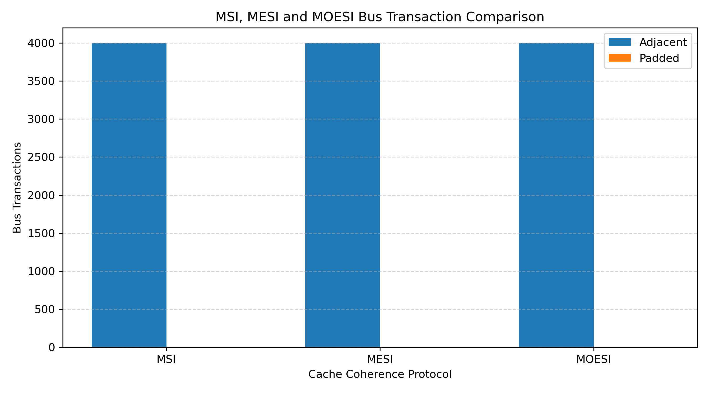
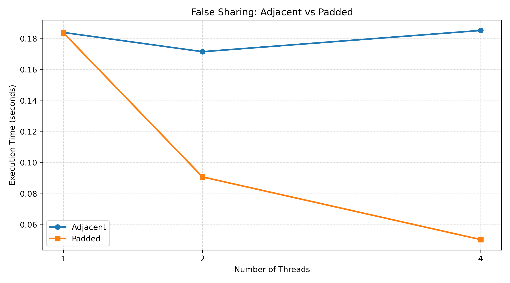
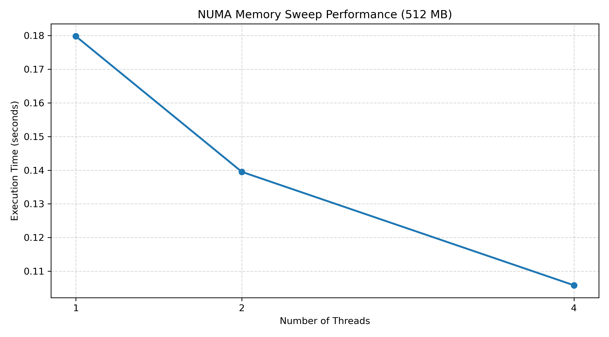
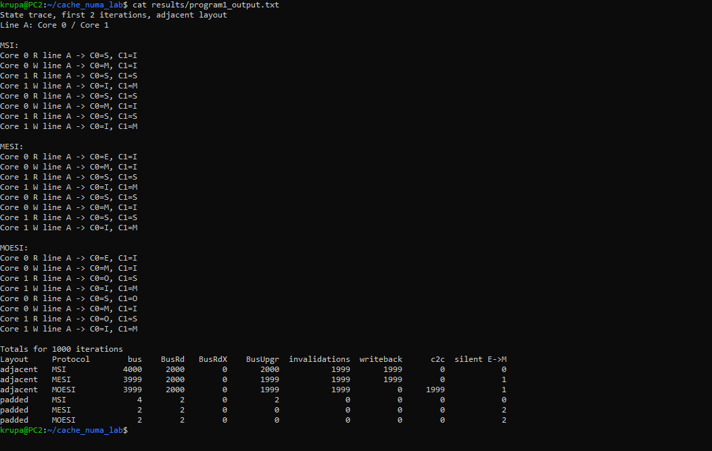
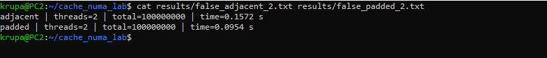
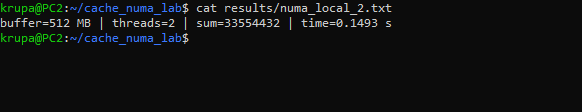
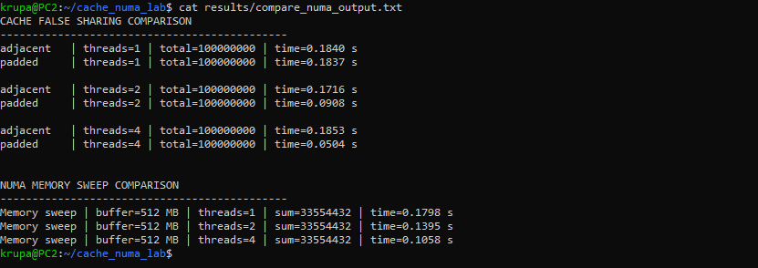

cd ~/cache_numa_lab

cat > README.md <<'EOF'
# Analyze Cache Coherence (MSI, MESI, MOESI) and NUMA Memory Access Performance

A Parallel and Distributed Computing laboratory experiment studying cache coherence protocols, false sharing, and NUMA memory access performance.

The experiment implements and compares:

- MSI, MESI, and MOESI cache coherence protocols using a Python simulator.
- Adjacent and padded memory layouts using OpenMP.
- NUMA memory access using `numactl`.
- Execution time and scalability using different thread counts.

The experiment demonstrates how cache-line sharing, memory layout, cache coherence traffic, and memory placement affect parallel program performance.

## Table of Contents

1. [Problem Statement](#1-problem-statement)
2. [Objectives](#2-objectives)
3. [Components and Configuration](#3-components-and-configuration)
4. [Theory](#4-theory)
   - [4.1 Cache Coherence](#41-why-cache-coherence-is-needed)
   - [4.2 Cache Line and False Sharing](#42-cache-line-and-false-sharing)
   - [4.3 MSI Protocol](#43-msi-protocol)
   - [4.4 MESI Protocol](#44-mesi-protocol)
   - [4.5 MOESI Protocol](#45-moesi-protocol)
   - [4.6 NUMA Architecture](#46-numa-architecture)
5. [System Architecture](#5-system-architecture)
6. [Installation and Environment Setup](#6-installation-and-environment-setup)
   - [6.1 WSL and Ubuntu](#61-wsl-and-ubuntu)
   - [6.2 GCC and OpenMP](#62-gcc-and-openmp)
   - [6.3 NUMA Tools](#63-numa-tools)
   - [6.4 Python and Matplotlib](#64-python-and-matplotlib)
   - [6.5 System Verification](#65-system-verification)
7. [Part A - Cache Coherence Protocol Simulator](#7-part-a---cache-coherence-protocol-simulator)
   - [7.1 Source Code](#71-source-code)
   - [7.2 Compilation and Execution](#72-compilation-and-execution)
   - [7.3 Protocol Results](#73-protocol-results)
8. [Part B - False Sharing Experiment](#8-part-b---false-sharing-experiment)
   - [8.1 Adjacent Memory Layout](#81-adjacent-memory-layout)
   - [8.2 Padded Memory Layout](#82-padded-memory-layout)
   - [8.3 Compilation and Execution](#83-compilation-and-execution)
   - [8.4 Performance Results](#84-performance-results)
9. [Part C - NUMA Memory Access Experiment](#9-part-c---numa-memory-access-experiment)
   - [9.1 NUMA Topology](#91-numa-topology)
   - [9.2 Memory Sweep Program](#92-memory-sweep-program)
   - [9.3 Local Memory Execution](#93-local-memory-execution)
10. [Part D - Combined Performance Comparison](#10-part-d---combined-performance-comparison)
    - [10.1 Compilation and Execution](#101-compilation-and-execution)
    - [10.2 False Sharing Comparison](#102-false-sharing-comparison)
    - [10.3 Memory Sweep Comparison](#103-memory-sweep-comparison)
11. [Execution Steps](#11-execution-steps)
12. [Experimental Graphs](#12-experimental-graphs)
13. [Execution Screenshots](#13-execution-screenshots)
14. [Observation and Comparison](#14-observation-and-comparison)
15. [Limitations](#15-limitations)
16. [Troubleshooting](#16-troubleshooting)
17. [Conclusion](#17-conclusion)
18. [Author](#18-author)

---

## 1. Problem Statement

In a multi-core processor, each CPU core has its own private cache. When multiple cores access shared memory, cache coherence protocols are required to maintain consistency between their cached copies.

This experiment studies three cache coherence protocols:

- MSI (Modified, Shared, Invalid)
- MESI (Modified, Exclusive, Shared, Invalid)
- MOESI (Modified, Owned, Exclusive, Shared, Invalid)

It also examines false sharing, where different threads update separate variables that occupy the same cache line.

The experiment compares adjacent and padded memory layouts to understand how cache-line sharing affects execution time and scalability.

Finally, NUMA memory access is studied using memory allocation and CPU binding tools.

## 2. Objectives

The objectives of this experiment are:

- To understand why cache coherence is required in multi-core processors.
- To simulate MSI, MESI, and MOESI cache coherence protocols.
- To understand cache-line states and bus transactions.
- To study the effect of false sharing on parallel programs.
- To compare adjacent and padded memory layouts.
- To implement parallel counter updates using OpenMP.
- To measure execution time using different thread counts.
- To examine NUMA topology and memory placement using `numactl`.
- To generate graphs and compare experimental performance.

## 3. Components and Configuration

### 3.1 Hardware Configuration

| Component | Configuration |
|---|---|
| Host System | Windows |
| Execution Environment | WSL |
| Processor | Intel Core i5-7200U |
| Physical Cores | 2 |
| Logical CPUs | 4 |
| NUMA Nodes | 1 |

### 3.2 Software Requirements

| Software / Tool | Purpose |
|---|---|
| Windows PowerShell | WSL launch and management |
| WSL | Linux execution environment |
| Ubuntu 26.04.1 LTS | Operating system |
| GCC | C program compilation |
| OpenMP | Shared-memory parallel programming |
| Python 3 | Cache coherence simulation |
| Matplotlib | Graph generation |
| numactl | NUMA topology and memory binding |
| hwloc | Hardware topology inspection |
| Git | Version control |
| GitHub | Source code and experiment documentation |

### 3.3 Compiler and Runtime Configuration

| Component | Version / Configuration |
|---|---|
| GCC | 15.2.0 |
| Python | 3.14.4 |
| OpenMP | GCC OpenMP runtime |
| Matplotlib | Installed |
| NUMA Utility | numactl |
| Memory Buffer | 512 MB |
| Cache Line Assumption | 64 bytes |

## 4. Theory

### 4.1 Why Cache Coherence Is Needed

In a multi-core processor, every core may have its own private cache.

When two cores load the same memory location, each core can hold its own copy. If one core modifies its copy, another core's cached copy may become stale.

Cache coherence protocols ensure that processor cores maintain a consistent view of shared memory.

In snooping-based protocols, each cache monitors the shared bus or interconnect and responds to memory operations performed by other cores.

### 4.2 Cache Line and False Sharing

Cache coherence is maintained at the cache-line level rather than the individual variable level.

A typical cache line is 64 bytes.

When two threads update different variables that occupy the same cache line, the cache line may repeatedly move between processor cores.

This is called **false sharing**.

Although the threads access different variables, cache coherence operates on the entire cache line.

The common solution is padding or alignment, which places frequently updated variables on separate cache lines.

### 4.3 MSI Protocol

MSI uses three cache states:

| State | Meaning |
|---|---|
| Modified (M) | Cache has the only valid, modified copy |
| Shared (S) | Cache has a clean copy that may be shared |
| Invalid (I) | Cache copy is not valid |

A read miss generates a BusRd transaction.

A write to a Shared line generates a BusUpgr transaction to invalidate other copies.

A write miss may generate a BusRdX transaction.

### 4.4 MESI Protocol

MESI adds the Exclusive state to MSI.

| State | Meaning |
|---|---|
| Modified (M) | Only valid copy, modified |
| Exclusive (E) | Only copy, clean |
| Shared (S) | Clean copy, possibly held by multiple caches |
| Invalid (I) | Invalid cache copy |

When a core has a line in Exclusive state, it can modify the line by transitioning from E to M without generating an additional bus transaction.

This reduces coherence traffic for private data.

### 4.5 MOESI Protocol

MOESI adds the Owned state to MESI.

| State | Meaning |
|---|---|
| Modified (M) | Modified, exclusive copy |
| Owned (O) | Modified copy that can be shared; owner supplies data |
| Exclusive (E) | Clean, exclusive copy |
| Shared (S) | Shared clean copy |
| Invalid (I) | Invalid cache copy |

The Owned state allows a cache to supply modified data directly to another cache without immediately writing the data back to main memory.

### 4.6 NUMA Architecture

NUMA stands for Non-Uniform Memory Access.

In a NUMA system, memory is divided among multiple nodes.

A processor accesses memory attached to its own node using local access. Accessing memory attached to another node requires communication through an interconnect and is generally slower.

Linux supports memory placement policies such as first-touch allocation.

The `numactl` utility can control CPU and memory placement:

```bash
numactl --hardware
numactl --cpunodebind=0 --membind=0 ./numa_sweep 512
```

A genuine local-versus-remote comparison requires at least two available NUMA nodes.

## 5. System Architecture

### 5.1 Overall Experiment Architecture

```text
                 Multi-Core Processor
                         |
              +----------+----------+
              |                     |
           Core 0                Core 1
              |                     |
          Private Cache         Private Cache
              |                     |
              +----------+----------+
                         |
                  Shared Memory
                         |
            Cache Coherence Protocols
                 MSI / MESI / MOESI
                         |
                 False Sharing Test
                         |
                Adjacent / Padded
                         |
                  OpenMP Threads
                         |
                  NUMA Memory Test
                         |
                 Performance Results
                         |
                    Graphs
```

### 5.2 Two-Counter Example

The experiment uses two threads, each updating its own counter.

**Adjacent layout**

```text
Cache Line A (64 bytes)
+-------------------+-------------------+
|    Counter X      |    Counter Y      |
|     Thread 0      |     Thread 1      |
+-------------------+-------------------+

Both counters share the same cache line.
```

**Padded layout**

```text
Cache Line A                 Cache Line B
+-------------------+       +-------------------+
|    Counter X      |       |    Counter Y      |
|     Thread 0      |       |     Thread 1      |
+-------------------+       +-------------------+

Each counter occupies a separate cache line.
```

Padding reduces unnecessary cache-line invalidations between cores.

## 6. Installation and Environment Setup

### 6.1 WSL and Ubuntu

The experiment was performed using Ubuntu inside Windows Subsystem for Linux.

Open Windows PowerShell and launch Ubuntu:

```powershell
wsl
```

Check the Ubuntu version:

```bash
lsb_release -a
```

### 6.2 GCC and OpenMP

Update the package list:

```bash
sudo apt update
```

Install GCC and build tools:

```bash
sudo apt install build-essential -y
```

Verify GCC:

```bash
gcc --version
```

Verify OpenMP support:

```bash
echo '#include <omp.h>' | gcc -E -fopenmp -xc - > /dev/null && echo "OpenMP OK"
```

### 6.3 NUMA Tools

Install NUMA utilities:

```bash
sudo apt install numactl hwloc -y
```

Verify the NUMA topology:

```bash
numactl --hardware
```

### 6.4 Python and Matplotlib

Install Python:

```bash
sudo apt install python3 python3-matplotlib -y
```

Verify Python:

```bash
python3 --version
```

Verify Matplotlib:

```bash
python3 -c "import matplotlib; print('Matplotlib installed')"
```

### 6.5 System Verification

Check processor information:

```bash
lscpu
```

Check available CPUs:

```bash
nproc
```

Check NUMA topology:

```bash
numactl --hardware
```

The experiment system reports one NUMA node with CPUs 0, 1, 2, and 3.

## 7. Part A - Cache Coherence Protocol Simulator

The first program simulates MSI, MESI, and MOESI cache coherence protocols using Python.

The simulator models two processor cores performing read and write operations.

It tracks:

- Cache states.
- Bus read transactions.
- Bus read-for-ownership transactions.
- Bus upgrade transactions.
- Invalidations.
- Writebacks.
- Cache-to-cache transfers.
- Silent Exclusive-to-Modified transitions.

### 7.1 Source Code

The Python source file is:

```text
coherence_sim.py
```

The simulator models two memory layouts:

- Adjacent: Both counters share cache line A.
- Padded: The counters occupy separate cache lines A and B.

### 7.2 Compilation and Execution

Navigate to the experiment directory:

```bash
cd ~/cache_numa_lab
```

Run the simulator:

```bash
python3 coherence_sim.py 1000
```

Save the output:

```bash
python3 coherence_sim.py 1000 | tee results/program1_output.txt
```

### 7.3 Protocol Results

#### Cache State Transitions

| Operation | MSI (C0/C1) | MESI (C0/C1) | MOESI (C0/C1) |
|---|---|---|---|
| Core 0 reads | S / I | E / I | E / I |
| Core 0 writes | M / I | M / I | M / I |
| Core 1 reads | S / S | S / S | O / S |
| Core 1 writes | I / M | I / M | I / M |
| Core 0 reads | S / S | S / S | S / O |
| Core 0 writes | M / I | M / I | M / I |
| Core 1 reads | S / S | S / S | O / S |
| Core 1 writes | I / M | I / M | I / M |

#### Total Transactions for 1000 Iterations

| Layout | Protocol | Bus Transactions | BusRd | BusRdX | BusUpgr | Invalidations | Writebacks | C2C |
|---|---|---:|---:|---:|---:|---:|---:|---:|
| Adjacent | MSI | 4000 | 2000 | 0 | 2000 | 1999 | 1999 | 0 |
| Adjacent | MESI | 3999 | 2000 | 0 | 1999 | 1999 | 1999 | 0 |
| Adjacent | MOESI | 3999 | 2000 | 0 | 1999 | 1999 | 0 | 1999 |
| Padded | MSI | 4 | 2 | 0 | 2 | 0 | 0 | 0 |
| Padded | MESI | 2 | 2 | 0 | 0 | 0 | 0 | 0 |
| Padded | MOESI | 2 | 2 | 0 | 0 | 0 | 0 | 0 |

**Result:** The padded layout significantly reduces modeled bus transactions because the two independent counters no longer share the same cache line.

## 8. Part B - False Sharing Experiment

This experiment demonstrates false sharing using OpenMP.

Two or more threads update independent counters.

The program compares adjacent and padded memory layouts.

### 8.1 Adjacent Memory Layout

In the adjacent layout, the counters are stored close together.

They may occupy the same cache line, causing cache-line invalidations when different threads update their own counters.

### 8.2 Padded Memory Layout

In the padded layout, each counter is separated by eight `long` elements.

Assuming eight-byte `long` values:

```text
8 × 8 bytes = 64 bytes
```

This separates the counters by one typical cache-line size.

### 8.3 Compilation and Execution

Compile the C program:

```bash
gcc -O2 false_sharing.c -fopenmp -o false_sharing
```

Run adjacent layout:

```bash
OMP_NUM_THREADS=2 ./false_sharing adjacent
```

Run padded layout:

```bash
OMP_NUM_THREADS=2 ./false_sharing padded
```

Save the results:

```bash
OMP_NUM_THREADS=2 ./false_sharing adjacent | tee results/false_adjacent_2.txt
OMP_NUM_THREADS=2 ./false_sharing padded | tee results/false_padded_2.txt
```

### 8.4 Performance Results

The combined comparison program was used to measure performance at 1, 2, and 4 threads.

| Threads | Adjacent Time (s) | Padded Time (s) |
|---:|---:|---:|
| 1 | 0.1840 | 0.1837 |
| 2 | 0.1716 | 0.0908 |
| 4 | 0.1853 | 0.0504 |

All runs produced the correct total:

```text
100000000
```

**Result:** The padded layout performed better with multiple threads in the recorded experiment.

## 9. Part C - NUMA Memory Access Experiment

This experiment measures memory access performance using a 512 MB buffer and OpenMP.

The program initializes the buffer and performs four memory-reading passes.

### 9.1 NUMA Topology

Check the NUMA hardware configuration:

```bash
numactl --hardware
```

The system reports:

```text
available: 1 nodes (0)
node 0 cpus: 0 1 2 3
```

Therefore, only NUMA node 0 is available in this environment.

### 9.2 Memory Sweep Program

The C source file is:

```text
numa_sweep.c
```

The program:

1. Allocates a 512 MB memory buffer.
2. Initializes the buffer.
3. Reads one value per 64-byte cache line.
4. Performs four passes.
5. Uses OpenMP reduction to calculate the sum.
6. Measures execution time.

Compile:

```bash
gcc -O2 numa_sweep.c -fopenmp -o numa_sweep
```

### 9.3 Local Memory Execution

Run with two threads and bind CPU and memory to NUMA node 0:

```bash
OMP_NUM_THREADS=2 numactl --cpunodebind=0 --membind=0 ./numa_sweep 512
```

Run without explicit NUMA binding:

```bash
OMP_NUM_THREADS=2 ./numa_sweep 512
```

Recorded local NUMA result:

| Buffer Size | Threads | Sum | Execution Time |
|---|---:|---:|---:|
| 512 MB | 2 | 33554432 | 0.1493 s |

The expected sum is 33,554,432.

**Result:** Local NUMA memory access was successfully tested using node 0.

## 10. Part D - Combined Performance Comparison

The combined program compares false sharing and memory sweep performance using different thread counts.

The source file is:

```text
compare_numa.c
```

### 10.1 Compilation and Execution

Compile:

```bash
gcc -O2 compare_numa.c -fopenmp -o compare_numa
```

Execute:

```bash
./compare_numa
```

Save the output:

```bash
./compare_numa | tee results/compare_numa_output.txt
```

### 10.2 False Sharing Comparison

The program compares adjacent and padded layouts using 1, 2, and 4 threads.

| Threads | Adjacent Time (s) | Padded Time (s) |
|---:|---:|---:|
| 1 | 0.1840 | 0.1837 |
| 2 | 0.1716 | 0.0908 |
| 4 | 0.1853 | 0.0504 |

The final count was 100,000,000 for all configurations.

### 10.3 Memory Sweep Comparison

The memory sweep was performed using a 512 MB buffer.

| Buffer Size | Threads | Sum | Execution Time |
|---|---:|---:|---:|
| 512 MB | 1 | 33554432 | 0.1798 s |
| 512 MB | 2 | 33554432 | 0.1395 s |
| 512 MB | 4 | 33554432 | 0.1058 s |

**Result:** In this recorded run, execution time decreased as the number of threads increased.

## 11. Execution Steps

The following commands summarize the complete experiment.

| Step | Command | Purpose |
|---|---|---|
| 1 | `sudo apt update` | Update package information |
| 2 | `sudo apt install build-essential numactl hwloc python3 python3-matplotlib -y` | Install required tools |
| 3 | `gcc --version` | Verify GCC |
| 4 | `numactl --hardware` | Check NUMA topology |
| 5 | `python3 coherence_sim.py 1000` | Run cache coherence simulation |
| 6 | `gcc -O2 false_sharing.c -fopenmp -o false_sharing` | Compile false sharing program |
| 7 | `gcc -O2 numa_sweep.c -fopenmp -o numa_sweep` | Compile NUMA program |
| 8 | `gcc -O2 compare_numa.c -fopenmp -o compare_numa` | Compile combined program |
| 9 | `OMP_NUM_THREADS=2 ./false_sharing adjacent` | Run adjacent layout |
| 10 | `OMP_NUM_THREADS=2 ./false_sharing padded` | Run padded layout |
| 11 | `numactl --cpunodebind=0 --membind=0 ./numa_sweep 512` | Run local NUMA test |
| 12 | `./compare_numa` | Run combined comparison |
| 13 | `python3 plot_results.py` | Generate graphs |

## 12. Experimental Graphs

### 12.1 Cache Coherence Comparison

This graph compares the bus transactions generated by MSI, MESI, and MOESI for adjacent and padded layouts.



### 12.2 False Sharing Performance

This graph compares adjacent and padded execution times for different thread counts.



### 12.3 NUMA Memory Performance

This graph compares memory sweep execution time for different thread counts.



## 13. Execution Screenshots

### 13.1 Cache Coherence Protocol Simulation



### 13.2 False Sharing Execution



### 13.3 NUMA Memory Access Execution



### 13.4 Combined Performance Comparison



## 14. Observation and Comparison

| Case | Correctness | Performance Observation | Scalability |
|---|---|---|---|
| MSI | Correct | Requires an upgrade for a Shared line | More bus transactions in the modeled trace |
| MESI | Correct | Exclusive state allows silent E-to-M transition | Reduces transactions for private data |
| MOESI | Correct | Owned state supports cache-to-cache transfer without immediate writeback | Reduces modeled memory writebacks |
| Adjacent Counters | Correct | Cache-line sharing causes false sharing | Can reduce performance with multiple threads |
| Padded Counters | Correct | Separate cache lines reduce false sharing | Better performance in the recorded multi-threaded run |
| Local NUMA | Correct | Memory bound to node 0 | Local access tested successfully |

### Important Observations

1. Cache coherence protocols maintain consistency between processor caches.
2. MSI, MESI, and MOESI use different cache states and coherence transactions.
3. MESI introduces the Exclusive state, which can eliminate an upgrade transaction.
4. MOESI introduces the Owned state, which allows dirty data to be shared.
5. False sharing occurs when independent variables occupy the same cache line.
6. Padding reduces false sharing by separating the counters.
7. The padded layout showed better execution time with 2 and 4 threads in the recorded results.
8. The memory sweep became faster with additional threads in the recorded run.
9. Execution times depend on CPU load, WSL configuration, and system resources.

## 15. Limitations

The experiment was executed using WSL on a system reporting only one NUMA node.

Therefore:

- Only local NUMA node 0 could be tested.
- A genuine remote NUMA memory access comparison could not be performed.
- No remote NUMA node was available for `--membind=1`.
- The cache coherence protocol results are produced by a software simulator, not direct hardware performance-counter measurements.
- Execution times may vary between runs due to system load and WSL resource allocation.

A genuine local-versus-remote NUMA comparison requires a system exposing at least two NUMA nodes.

## 16. Troubleshooting

| Problem | Solution |
|---|---|
| `gcc: command not found` | Install `build-essential` |
| OpenMP compilation error | Include `-fopenmp` during compilation |
| `numactl: command not found` | Install `numactl` |
| Matplotlib import error | Install `python3-matplotlib` |
| `wsl: command not found` inside Ubuntu | Launch WSL from Windows PowerShell |
| Remote NUMA node unavailable | Check `numactl --hardware`; this system exposes only node 0 |
| Incorrect output total | Verify the program and thread configuration |
| Graphs not generated | Run `python3 plot_results.py` |

## 17. Conclusion

This experiment studied cache coherence protocols, false sharing, and NUMA memory access performance.

The MSI, MESI, and MOESI simulator demonstrated how cache states and bus transactions change during read and write operations.

The false sharing experiment showed that adjacent counters can cause unnecessary cache-line sharing, while padding separates the counters and improves performance in the recorded multi-threaded tests.

The NUMA experiment demonstrated memory allocation and local node binding using `numactl`. Since the WSL environment exposed only one NUMA node, remote NUMA access could not be measured.

Overall, the experiment provided practical understanding of cache coherence, cache-line organization, false sharing, OpenMP parallelism, and NUMA memory placement.

## 18. Author

**Krupa1310**

CSE (Artificial Intelligence)  
K.L.E. Technological University, Hubli

---

## Repository Structure

```text
cache_numa_lab/
│
├── README.md
│
├── coherence_sim.py
├── false_sharing.c
├── numa_sweep.c
├── compare_numa.c
├── plot_results.py
│
├── results/
│   ├── program1_output.txt
│   ├── false_adjacent_2.txt
│   ├── false_padded_2.txt
│   ├── numa_local_2.txt
│   └── compare_numa_output.txt
│
├── graphs/
│   ├── 01_cache_coherence_comparison.png
│   ├── 02_false_sharing_performance.png
│   └── 03_numa_memory_performance.png
│
└── screenshots/
    ├── 01_cache_coherence.png
    ├── 02_false_sharing.png
    ├── 03_numa_memory.png
    └── 04_combined_comparison.png
```
EOF


