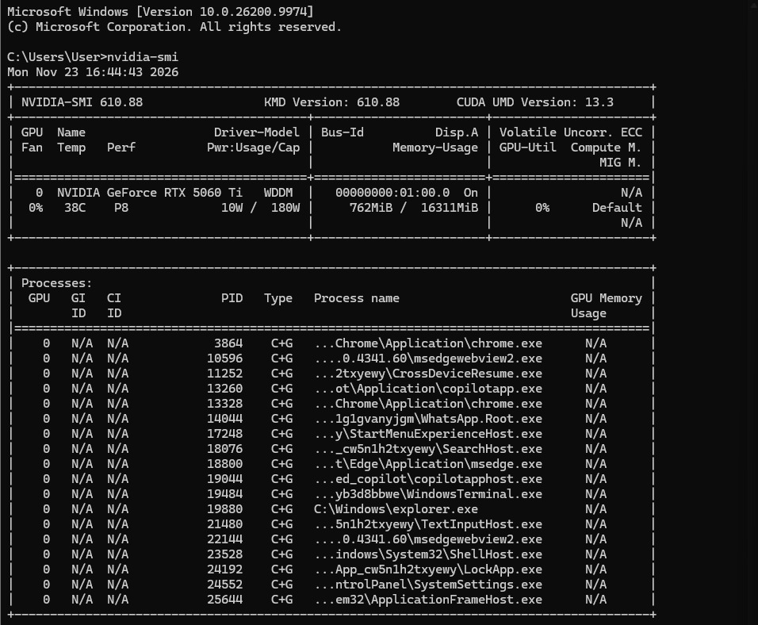
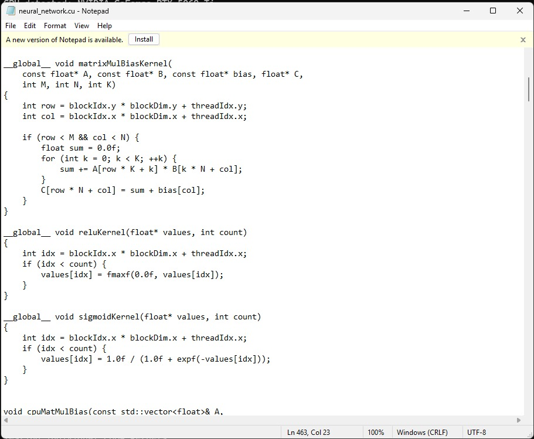
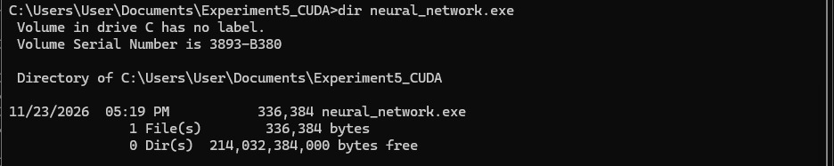
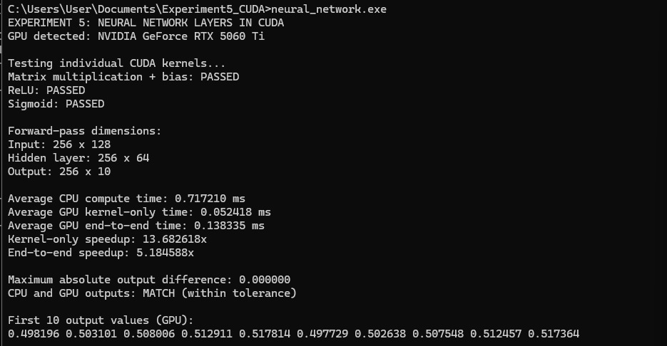
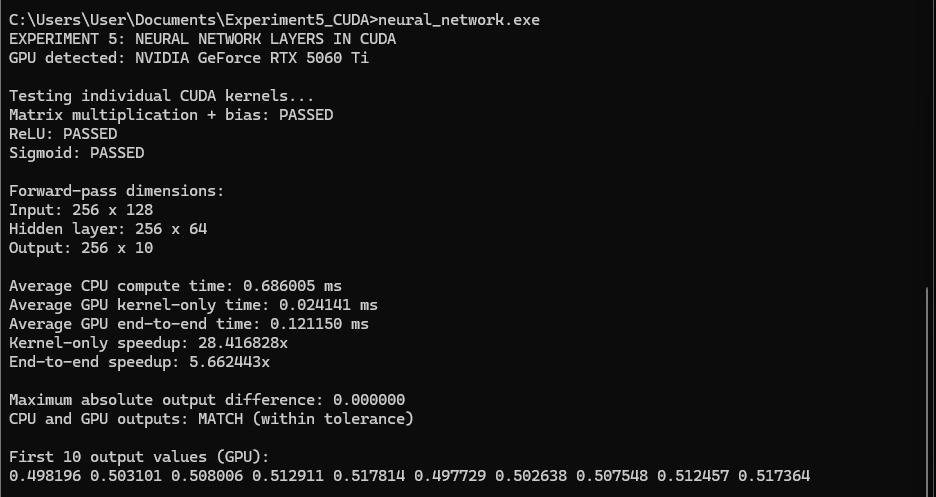

# Experiment 5: Neural Network Layers in CUDA

A Parallel and Distributed Computing laboratory experiment implementing basic neural-network layers using custom CUDA kernels and comparing CPU and GPU execution performance.

This experiment implements matrix multiplication with bias, ReLU activation, and sigmoid activation. The operations are combined into a two-layer neural-network forward pass. The same computation is performed on the CPU and GPU to validate numerical correctness and measure execution time and GPU speedup.

## Table of Contents

1. Aim
2. Objectives
3. Hardware and Software Requirements
4. Theory
   - 4.1 Neural Network Forward Pass
   - 4.2 Matrix Multiplication with Bias
   - 4.3 ReLU Activation
   - 4.4 Sigmoid Activation
   - 4.5 CPU and GPU Execution
5. Network Configuration
6. System Architecture
7. Implementation Overview
8. Compilation and Execution
9. Kernel Testing and Validation
10. Performance Measurement
11. Observation and Comparison
12. Execution Screenshots
13. Precautions
14. Troubleshooting
15. Conclusion
16. Author

---

## 1. Aim

To implement and evaluate basic neural-network layers using custom CUDA kernels:

- Matrix multiplication with bias
- ReLU activation
- Sigmoid activation

Execute the same forward pass on the CPU and GPU, validate numerical correctness, measure execution time, and calculate GPU speedup.

## 2. Objectives

The objectives of this experiment are:

- To understand CUDA kernels, blocks, threads, and grid dimensions.
- To implement matrix multiplication with bias using CUDA.
- To implement ReLU and sigmoid activation kernels.
- To allocate and transfer data between host and device memory.
- To compare CPU and GPU computation results.
- To measure CPU and GPU execution time.
- To calculate kernel-only and end-to-end GPU speedup.
- To validate the numerical correctness of the neural-network forward pass.

## 3. Hardware and Software Requirements

### 3.1 Hardware Requirements

| Component | Requirement |
|---|---|
| Processor | Windows-compatible 64-bit processor |
| GPU | NVIDIA CUDA-capable GPU |
| RAM | Sufficient system memory |
| Operating System | Windows 10/11 64-bit |

### 3.2 Software Requirements

| Software / Tool | Purpose |
|---|---|
| NVIDIA GPU Driver | GPU driver support |
| CUDA Toolkit | CUDA development environment |
| NVCC | CUDA compiler |
| Visual Studio 2022 Build Tools | C++ compilation |
| MSVC v143 | Microsoft C++ compiler |
| Windows SDK | Required build tools |
| Git | Version control |
| GitHub | Experiment documentation and screenshots |

### 3.3 System Verification

The following commands are used to verify the CUDA environment:

```bash
nvidia-smi
nvcc --version
where.exe nvcc
where cl
```

The NVIDIA GPU driver, CUDA compiler, and Microsoft C++ compiler must be available before compiling the program.

## 4. Theory

A neural-network forward pass computes outputs by applying weighted sums and activation functions.

This experiment uses a two-layer feed-forward neural network.

### 4.1 Neural Network Forward Pass

The network performs the following operations:

**Layer 1:**

```text
Z1 = X × W1 + b1
A1 = ReLU(Z1)
```

**Layer 2:**

```text
Z2 = A1 × W2 + b2
Y = Sigmoid(Z2)
```

The forward pass consists of matrix multiplication with bias followed by activation functions.

This experiment performs inference (forward propagation) only. It does not include training, loss calculation, optimization, or backpropagation.

### 4.2 Matrix Multiplication with Bias

For matrices A and B:

- A has dimensions M × K.
- B has dimensions K × N.
- The output C has dimensions M × N.

The computation is:

```text
C[row, col] = Σ A[row, k] × B[k, col] + bias[col]
```

Each CUDA thread calculates one output matrix element and adds the corresponding bias value.

### 4.3 ReLU Activation

ReLU stands for Rectified Linear Unit.

Formula:

```text
ReLU(x) = max(0, x)
```

- Negative values are converted to zero.
- Positive values remain unchanged.

Each CUDA thread processes one array element.

### 4.4 Sigmoid Activation

The sigmoid activation function maps real-valued inputs into values between 0 and 1.

Formula:

```text
Sigmoid(x) = 1 / (1 + exp(-x))
```

Each CUDA thread processes one element.

### 4.5 CPU and GPU Execution

**CPU Execution:**

- Uses ordinary nested loops and standard C++ functions.
- Performs the complete neural-network forward pass.
- Acts as the reference computation for comparison.

**GPU Execution:**

- Allocates device memory.
- Transfers inputs, weights, and biases from host to device.
- Launches CUDA kernels in sequence.
- Copies the final output back to the host.

CUDA kernels launched on the same default stream execute in launch order, preserving the forward-pass dependency.

## 5. Network Configuration

The experiment uses deterministic input values generated using sine and cosine functions. Therefore, the CPU and GPU receive identical inputs and weights.

### 5.1 Network Parameters

| Parameter | Value |
|---|---:|
| BATCH | 256 |
| INPUT_SIZE | 128 |
| HIDDEN_SIZE | 64 |
| OUTPUT_SIZE | 10 |
| REPEATS | 20 |

### 5.2 Tensor Dimensions

| Tensor | Dimensions |
|---|---|
| Input X | 256 × 128 |
| Weight W1 | 128 × 64 |
| Bias b1 | 64 elements |
| Hidden activation | 256 × 64 |
| Weight W2 | 64 × 10 |
| Bias b2 | 10 elements |
| Final output | 256 × 10 |

## 6. System Architecture

### 6.1 Overall Architecture

```text
                Input Data (X)
                       |
                       v
             Matrix Multiplication
                       |
                  Add Bias (b1)
                       |
                       v
                 ReLU Activation
                       |
                       v
             Matrix Multiplication
                       |
                  Add Bias (b2)
                       |
                       v
               Sigmoid Activation
                       |
                       v
                 Final Output
                       |
             +---------+---------+
             |                   |
             v                   v
          CPU Output          GPU Output
             |                   |
             +---------+---------+
                       |
                       v
               Result Comparison
                       |
                       v
              Numerical Validation
                       |
                       v
               Performance Analysis
```

### 6.2 CUDA Execution Model

CUDA uses a hierarchy of grids, blocks, and threads.

- **Thread:** Executes an individual computation.
- **Block:** Contains a group of threads.
- **Grid:** Contains multiple thread blocks.
- **blockIdx:** Identifies the block.
- **threadIdx:** Identifies the thread within a block.
- **blockDim:** Specifies the dimensions of a block.

For matrix multiplication, each CUDA thread calculates one output element.

Boundary checks ensure that threads outside the matrix dimensions do not access invalid memory locations.

## 7. Implementation Overview

The program is developed in eight phases.

| Phase | Implementation | Purpose |
|---|---|---|
| 1 | Includes, CUDA_CHECK and constants | Loads libraries, handles CUDA errors, defines network dimensions |
| 2 | Three CUDA kernels | Implements matrix multiplication, ReLU and sigmoid |
| 3 | CPU functions | Implements the reference forward pass |
| 4 | GPU forward-pass function | Launches CUDA kernels in sequence |
| 5 | Kernel testing functions | Validates individual CUDA kernels |
| 6 | Start of main function | Detects GPU, runs tests, generates input data and measures CPU time |
| 7 | GPU memory and timing | Allocates device memory, transfers data, warms up GPU and measures execution |
| 8 | Comparison and output | Compares CPU and GPU results, prints performance and releases memory |

### 7.1 CUDA Kernels

The experiment implements three custom CUDA kernels:

1. `matrixMulBiasKernel()` – Performs matrix multiplication with bias.
2. `reluKernel()` – Applies ReLU activation.
3. `sigmoidKernel()` – Applies sigmoid activation.

### 7.2 CPU Functions

The CPU implementation includes:

- `cpuMatMulBias()`
- `cpuReLU()`
- `cpuSigmoid()`
- `cpuForwardPass()`

These functions perform the same operations as the GPU implementation.

### 7.3 Kernel Testing

Three individual kernel tests are performed using small input values with known expected outputs.

| Kernel | Test Input | Expected Output |
|---|---|---|
| Matrix multiplication + bias | A = [[1,2,3],[4,5,6]], B = [[1,2],[3,4],[5,6]], bias = [1,-1] | [[23,27],[50,63]] |
| ReLU | [-2, 0, 3, -4, 5] | [0, 0, 3, 0, 5] |
| Sigmoid | [-2, 0, 2] | Approximately [0.119203, 0.5, 0.880797] |

All three tests must pass before the complete forward pass continues.

## 8. Compilation and Execution

### 8.1 Environment Setup

Open the **Developer Command Prompt for VS 2022**.

Verify CUDA:

```bash
nvidia-smi
nvcc --version
```

Verify the Microsoft C++ compiler:

```bash
where cl
cl
```

### 8.2 Create the Project Directory

```bash
mkdir "%USERPROFILE%\Documents\Experiment5_CUDA"
cd /d "%USERPROFILE%\Documents\Experiment5_CUDA"
```

### 8.3 Create the CUDA Source File

```bash
notepad neural_network.cu
```

The CUDA program is saved as `neural_network.cu`.

### 8.4 Compile the Program

Compile using NVCC:

```bash
nvcc -O2 neural_network.cu -o neural_network.exe
```

### 8.5 Verify the Executable

```bash
dir neural_network.exe
```

### 8.6 Execute the Program

```bash
neural_network.exe
```

The program detects the NVIDIA GPU, executes the kernel tests, performs the CPU and GPU forward passes, compares the outputs, and displays performance measurements.

## 9. Kernel Testing and Validation

The program checks the correctness of all three CUDA kernels.

Expected validation output:

```text
Matrix multiplication + bias: PASSED
ReLU: PASSED
Sigmoid: PASSED
```

The complete forward pass is then executed on both CPU and GPU.

The maximum absolute output difference is calculated using:

```text
Maximum Difference = max |CPU_output[i] - GPU_output[i]|
```

The program declares the outputs as matching when:

```text
Maximum Difference < 1e-4
```

Expected validation:

```text
CPU and GPU outputs: MATCH (within tolerance)
```

## 10. Performance Measurement

The experiment measures three execution times.

### 10.1 CPU Compute Time

The CPU forward pass is executed 20 times, and the average execution time is calculated.

### 10.2 GPU Kernel-Only Time

CUDA events are used to measure repeated GPU kernel execution.

The inputs and weights are already stored in GPU memory. This measurement covers kernel execution only.

### 10.3 GPU End-to-End Time

The end-to-end measurement includes:

- Host-to-device data transfers.
- CUDA kernel execution.
- GPU synchronization.
- Device-to-host output transfer.

### 10.4 Speedup Calculation

**Kernel-only speedup:**

```text
CPU Average Compute Time / GPU Kernel-Only Time
```

**End-to-end speedup:**

```text
CPU Average Compute Time / GPU End-to-End Time
```

A speedup greater than 1 indicates that the measured GPU execution path is faster than the CPU computation for that measurement scope.

The end-to-end speedup is usually lower because it includes data-transfer and kernel-launch overhead.

## 11. Observation and Comparison

The experiment validates the correctness and performance of the neural-network layers implemented using CUDA.

| Component | Observation |
|---|---|
| Matrix multiplication + bias | Individual CUDA kernel is tested |
| ReLU activation | Negative values become zero |
| Sigmoid activation | Values are mapped between 0 and 1 |
| CPU execution | Performs the forward pass using C++ functions |
| GPU execution | Performs the forward pass using custom CUDA kernels |
| Kernel validation | All three kernel tests should pass |
| Numerical validation | CPU and GPU outputs should match within tolerance |
| Performance | CPU and GPU execution times are measured |
| Speedup | Kernel-only and end-to-end speedups are calculated |

### 11.1 Observation Table

Record the actual values from your execution screenshots. Timing values may vary between runs and systems.

| Measurement | Observed Value |
|---|---|
| GPU Model | Refer to execution screenshot |
| CPU Average Compute Time | Refer to execution screenshot |
| GPU Kernel-Only Time | Refer to execution screenshot |
| GPU End-to-End Time | Refer to execution screenshot |
| Kernel-Only Speedup | Refer to execution screenshot |
| End-to-End Speedup | Refer to execution screenshot |
| Maximum Absolute Difference | Refer to execution screenshot |
| Matrix Multiplication Test | PASSED |
| ReLU Test | PASSED |
| Sigmoid Test | PASSED |
| CPU/GPU Output Validation | MATCH (within tolerance) |

### 11.2 Important Observations

- CUDA kernels perform computations in parallel using GPU threads.
- Matrix multiplication with bias produces the weighted sum for each output element.
- ReLU removes negative values from the activation output.
- Sigmoid maps values into the range between 0 and 1.
- CPU and GPU results are compared to validate numerical correctness.
- GPU kernel-only timing excludes host-device data transfers.
- End-to-end timing includes memory transfers and kernel execution.
- GPU speedup depends on hardware, CUDA configuration, data-transfer overhead, and system load.
- Execution times can vary slightly between repeated runs.

## 12. Execution Screenshots

The following screenshots document the CUDA environment, source code, compilation, and successful execution of Experiment 5.

### 12.1 NVIDIA GPU Verification



### 12.2 CUDA Toolkit Verification


### 12.3 CUDA Source Code



### 12.4 Program Compilation



### 12.5 First Execution



### 12.6 Second Execution



## 13. Precautions

1. Use an NVIDIA CUDA-capable GPU with a compatible driver and CUDA Toolkit.
2. Open the Visual Studio x64 Developer Command Prompt so that `cl.exe` is available in PATH.
3. Save the source file using the `.cu` extension.
4. Use a writable project directory instead of `C:\Windows\System32`.
5. Maintain consistent matrix dimensions and memory allocation sizes.
6. Check CUDA errors and kernel test results before interpreting performance.
7. Verify CPU and GPU outputs before calculating speedup.
8. Execute the program multiple times to observe timing variations.

## 14. Troubleshooting

| Problem | Solution |
|---|---|
| `nvidia-smi` is not recognized | Check NVIDIA driver installation |
| `nvcc` is not recognized | Verify CUDA Toolkit installation and PATH |
| `cl.exe` not found | Open Developer Command Prompt for VS 2022 |
| `LNK1104` error | Use a writable directory and close any running executable |
| No CUDA device detected | Check GPU driver and CUDA compatibility |
| Kernel test fails | Verify kernel indexing, dimensions and memory transfers |
| CPU/GPU output mismatch | Check calculations, data allocation and kernel execution |
| Execution timings vary | Repeat the experiment and consider system load |

## 15. Conclusion

This experiment implemented basic neural-network layers using custom CUDA kernels, including matrix multiplication with bias, ReLU activation, and sigmoid activation.

The three CUDA kernels were tested individually using known input and expected output values. The kernels were then combined to perform a two-layer neural-network forward pass on the GPU.

The same forward pass was implemented on the CPU to validate numerical correctness. CPU and GPU outputs were compared using the maximum absolute difference, and execution times were measured to calculate kernel-only and end-to-end speedups.

Overall, the experiment provided practical understanding of CUDA programming, GPU memory management, thread and block organization, parallel computation, numerical validation, and GPU performance evaluation.

## 16. Author

**Krupa Akki**

CSE (Artificial Intelligence)  
K.L.E. Technological University, Hubli

GitHub: [Krupa1310](https://github.com/Krupa1310)

---

## Repository Structure

```text
PGC-Experiment-5-Neural Network Layers in CUDA/
│
├── README.md
│
└── Screenshots/
    ├── 01_nvidia-smi.png
    ├── 02_nvcc --version.png
    ├── 03_neural_network.cu.png
    ├── 04_compilation.png
    ├── 05_execution.png
    └── 06_execution_second_run.png
```
