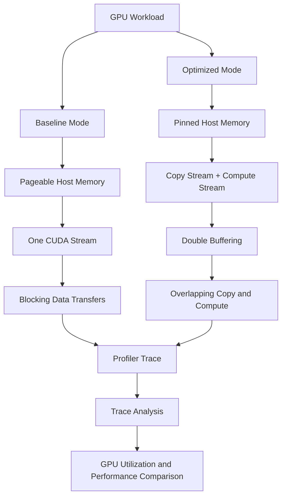

# PGC-Experiment-7-Profiling-and-GPU-Utilization

A Parallel and Distributed Computing laboratory experiment that profiles a GPU workload, identifies idle GPU time and host-device data transfers, and improves GPU utilization by overlapping data transfer with computation.

The experiment compares two execution modes:

1. **Baseline:** Pageable host memory, one CUDA stream, and blocking data transfers.
2. **Optimized:** Pinned host memory, two CUDA streams, and double buffering to overlap data transfer with computation.

The workload uses PyTorch with CUDA and `torch.profiler` to generate Chrome trace files. The traces are analyzed to estimate GPU kernel busy time, utilization, copy overlap, and idle gaps.

> **Note:** Numerical values shown in the Results section are the worked sample values from the lab manual. Replace them with measurements from your own GPU run before submitting the final lab report.

---

## Table of Contents

- [1. Aim](#1-aim)
- [2. Objectives and Learning Outcomes](#2-objectives-and-learning-outcomes)
- [3. Components and Configuration](#3-components-and-configuration)
- [4. Background Concepts](#4-background-concepts)
- [5. System Architecture](#5-system-architecture)
- [6. Repository Structure](#6-repository-structure)
- [7. Setup and Prerequisites](#7-setup-and-prerequisites)
  - [7.1 Hardware and Software Requirements](#71-hardware-and-software-requirements)
  - [7.2 GPU Verification](#72-gpu-verification)
  - [7.3 Python and PyTorch Setup](#73-python-and-pytorch-setup)
- [8. Part A - Baseline Profiling](#8-part-a---baseline-profiling)
  - [8.1 Start GPU Utilization Logging](#81-start-gpu-utilization-logging)
  - [8.2 Run the Baseline Workload](#82-run-the-baseline-workload)
  - [8.3 Analyze the Baseline Trace](#83-analyze-the-baseline-trace)
- [9. Part B - Kernel Classification](#9-part-b---kernel-classification)
- [10. Part C - Optimized GPU Execution](#10-part-c---optimized-gpu-execution)
  - [10.1 Pinned Host Memory](#101-pinned-host-memory)
  - [10.2 CUDA Streams and Double Buffering](#102-cuda-streams-and-double-buffering)
  - [10.3 Run the Optimized Workload](#103-run-the-optimized-workload)
- [11. Results and Performance Analysis](#11-results-and-performance-analysis)
  - [11.1 Baseline vs Optimized Results](#111-baseline-vs-optimized-results)
  - [11.2 Kernel Classification](#112-kernel-classification)
  - [11.3 Bottlenecks and Fixes](#113-bottlenecks-and-fixes)
- [12. Timeline Visualization](#12-timeline-visualization)
- [13. Troubleshooting](#13-troubleshooting)
- [14. Viva Questions](#14-viva-questions)
- [15. Conclusion](#15-conclusion)
- [16. Author](#16-author)

---

# 1. Aim

To profile a GPU workload to identify where execution time is lost and improve GPU utilization by overlapping data transfer with computation.

---

# 2. Objectives and Learning Outcomes

The objectives of this experiment are:

1. To capture the execution timeline of a GPU program.
2. To identify idle GPU gaps and host-to-device data transfers.
3. To understand the difference between pageable and pinned host memory.
4. To classify GPU kernels as compute-bound or memory-bound using arithmetic intensity.
5. To apply pinned host memory and two CUDA streams.
6. To use double buffering for safe asynchronous data transfer.
7. To overlap the transfer of the next batch with computation on the current batch.
8. To measure GPU utilization and total execution time.
9. To compare baseline and optimized execution.
10. To verify that both versions produce matching checksums.

---

# 3. Components and Configuration

## 3.1 Hardware Requirements

| Component | Requirement |
|---|---|
| GPU | NVIDIA GPU with CUDA support |
| GPU Memory | Approximately 2 GB free GPU memory |
| System Memory | Sufficient RAM for Python and workload batches |
| Driver | Up-to-date NVIDIA driver |

## 3.2 Software Requirements

| Software / Tool | Purpose |
|---|---|
| Python 3.9+ | Run the workload and analyzer |
| PyTorch with CUDA | GPU tensor operations |
| `torch.profiler` | Capture CPU and CUDA execution timeline |
| CUDA driver | GPU execution support |
| `nvidia-smi` | Monitor GPU utilization and memory |
| Perfetto or Chrome tracing | View Chrome trace JSON files |
| Nsight Systems | Optional GPU timeline visualization |
| Git and GitHub | Version control and source-code hosting |

---

# 4. Background Concepts

## 4.1 GPU Utilization

GPU utilization indicates how much of the sampled time the GPU is actively executing work. Time spent waiting for data, waiting for the CPU, or waiting for earlier operations can leave the GPU idle.

## 4.2 Pageable and Pinned Memory

- **Pageable memory:** Normal host memory. The operating system may move it, so the CUDA driver may need to copy it through a pinned staging buffer before transferring it to the GPU.
- **Pinned memory:** Page-locked host memory that can be accessed directly by the GPU's DMA engine. It supports asynchronous, non-blocking transfers.

Pinned memory can improve host-to-device transfer performance.

## 4.3 CUDA Streams

A CUDA stream is a sequence of GPU operations executed in order.

- Operations in one stream follow their submission order.
- Operations in different streams may execute concurrently when the hardware and driver support it.
- A copy stream can transfer the next batch while a compute stream processes the current batch.

## 4.4 Double Buffering

Two device buffers are used alternately:

- One buffer is used for computation.
- The other buffer can receive the next input batch.

CUDA events coordinate the streams and prevent a buffer from being overwritten before computation has finished using it.

## 4.5 Arithmetic Intensity

Arithmetic intensity (AI) is the number of floating-point operations performed per byte transferred from GPU memory.

```text
Arithmetic Intensity = FLOPs / Bytes moved
```

The ridge point is calculated as:

```text
Ridge Point = Peak FP32 FLOP/s / Peak Memory Bandwidth
```

- AI above the ridge point indicates a compute-bound kernel.
- AI below the ridge point indicates a memory-bound kernel.

---

# 5. System Architecture

The experiment executes the same GPU workload in two modes and compares their performance.



## 5.1 Baseline Execution Flow

```text
Host Batch
    |
    v
Host-to-Device Copy
    |
    v
GPU Kernel Execution
    |
    v
Device-to-Host Copy
    |
    v
Next Batch
```

In the baseline mode, copies and computation are performed sequentially. The GPU may remain idle while data is being transferred.

## 5.2 Optimized Execution Flow

```text
                 Copy Stream
                     |
             Copy next batch
                     |
                     v
              Device Buffer
                     |
                     v
                Compute Stream
                     |
              Process current batch
                     |
                     v
                Output Buffer
```

The optimized mode uses pinned memory, two streams, two device buffers, and CUDA events to allow data transfer and computation to overlap.

---

# 6. Repository Structure

```text
PGC-Experiment-7-Profiling-and-GPU-Utilization/
│
├── README.md
├── gpu_workload.py
├── analyze_trace.py
│
├── trace_baseline.json       # Generated after baseline profiling
├── trace_optimized.json      # Generated after optimized profiling
├── smi_baseline.csv          # Generated GPU utilization log
└── smi_optimized.csv         # Generated GPU utilization log
```

The trace and CSV files are generated when the experiment is executed. They should be added to the repository only if required by the lab submission.

---

# 7. Setup and Prerequisites

## 7.1 Hardware and Software Requirements

Before starting, ensure that:

- An NVIDIA GPU is available.
- The NVIDIA driver is installed and working.
- Python 3.9 or later is installed.
- Approximately 2 GB of GPU memory is free.
- Other GPU applications are closed to avoid affecting measurements.

## 7.2 GPU Verification

Open a terminal and check the GPU:

```bash
nvidia-smi
```

Check the Python version:

```bash
python --version
```

The NVIDIA GPU name and driver information should be displayed by `nvidia-smi`.

## 7.3 Python and PyTorch Setup

Install PyTorch with CUDA support. The following is the lab manual's example command for CUDA 12.1:

```bash
pip install torch --index-url https://download.pytorch.org/whl/cu121
```

If this build does not match the installed driver, select the suitable installation command from the official PyTorch installation page.

Verify CUDA availability:

```bash
python -c "import torch; print(torch.cuda.is_available(), torch.cuda.get_device_name(0))"
```

The command should display `True` followed by the NVIDIA GPU name.

Create the experiment directory and place both Python scripts inside it:

```bash
mkdir -p exp8
cd exp8
```

---

# 8. Part A - Baseline Profiling

The baseline uses pageable host memory, one stream, and blocking copies.

## 8.1 Start GPU Utilization Logging

Open a second terminal and start logging GPU utilization:

```bash
nvidia-smi --query-gpu=utilization.gpu,memory.used --format=csv -lms 100 > smi_baseline.csv
```

Keep this command running during the baseline workload. Stop it with `Ctrl+C` after the run.

## 8.2 Run the Baseline Workload

In the first terminal, execute:

```bash
python gpu_workload.py --mode baseline --profile
```

The program reports:

- GPU model
- Execution mode
- Number of batches
- Total execution time
- Time per batch
- Throughput
- Checksum

A trace file named `trace_baseline.json` is generated.

## 8.3 Analyze the Baseline Trace

Run:

```bash
python analyze_trace.py trace_baseline.json
```

The analyzer reports:

- Profiled time window
- GPU kernel busy time
- Estimated GPU utilization
- Memory-copy busy time
- Copy and kernel overlap
- Number and total duration of idle gaps
- Kernel names and their time

Open `trace_baseline.json` using Perfetto:

1. Open `https://ui.perfetto.dev`.
2. Select **Open trace file**.
3. Choose `trace_baseline.json`.
4. Inspect the GPU kernel and memory-copy rows.
5. Capture the baseline timeline screenshot.

---

# 9. Part B - Kernel Classification

The kernels are classified using arithmetic intensity.

| Kernel | FLOPs | Bytes moved | Arithmetic Intensity | Expected Classification |
|---|---:|---:|---:|---|
| GEMM | Approx. 34.4 G | Approx. 138 MB | Approx. 249 FLOP/byte | Compute-bound |
| ReLU / multiply / add | Approx. 16.8 M | Approx. 134 MB | 0.125 FLOP/byte | Memory-bound |
| Sum reduction | Approx. 16.8 M | Approx. 67 MB | 0.25 FLOP/byte | Memory-bound |

For the sample GPU in the lab manual:

```text
Peak FP32 performance = 12.7 TFLOP/s
Memory bandwidth      = 360 GB/s

Ridge Point = 12700 / 360
            ≈ 35 FLOP/byte
```

Therefore:

- GEMM has an arithmetic intensity of approximately 249 FLOP/byte, which is above the ridge point, so it is compute-bound.
- Element-wise operations and sum reduction have arithmetic intensities below the ridge point, so they are memory-bound.

Use the specifications of the actual GPU when calculating its ridge point.

---

# 10. Part C - Optimized GPU Execution

The optimized implementation uses pinned host memory, two CUDA streams, and double buffering.

## 10.1 Pinned Host Memory

The host batches are allocated using:

```python
t.pin_memory()
```

Pinned memory allows asynchronous, non-blocking host-to-device transfers.

## 10.2 CUDA Streams and Double Buffering

The optimized code creates two streams:

```python
copy_s = torch.cuda.Stream()
comp_s = torch.cuda.Stream()
```

- `copy_s` handles data transfer.
- `comp_s` handles computation.

Two GPU buffers are allocated:

```python
buf = [torch.empty(rows, cols, device="cuda") for _ in range(2)]
```

CUDA events coordinate access to the buffers:

- `copied` indicates that a buffer has received its input data.
- `freed` indicates that computation has finished using a buffer.

These events prevent data races and ensure that a buffer is not overwritten while a kernel is still reading it.

## 10.3 Run the Optimized Workload

In a second terminal, start GPU utilization logging:

```bash
nvidia-smi --query-gpu=utilization.gpu,memory.used --format=csv -lms 100 > smi_optimized.csv
```

In the first terminal, run:

```bash
python gpu_workload.py --mode optimized --profile
```

The program generates `trace_optimized.json`.

Check that the optimized checksum matches the baseline checksum. Small differences in the last digits may be acceptable.

Analyze both traces:

```bash
python analyze_trace.py trace_baseline.json trace_optimized.json
```

The summary compares utilization, copy overlap, and idle gaps for both modes.

---

# 11. Results and Performance Analysis

> **Important:** The following values are sample results provided in the lab manual. They are not measurements from every GPU. Replace them with your own experiment results.

## 11.1 Baseline vs Optimized Results

| Metric (200 batches) | Baseline | Optimized | Change |
|---|---:|---:|---:|
| Total time | 4.76 s | 2.62 s | 1.82× faster |
| Time per batch | 23.8 ms | 13.1 ms | 10.7 ms lower |
| Throughput | 42 batches/s | 76 batches/s | 81% higher |
| Average GPU utilization (`nvidia-smi`) | Approx. 55% | Approx. 96% | +41 percentage points |
| Kernel busy / window (analyzer) | 52% | 94% | +42 percentage points |
| Idle gaps above 50 μs | 9 (approx. 102 ms) | 0 | Removed in sample |
| Copy time overlapped with kernels | 0 ms | Approx. 50 ms | Overlap achieved |
| Host-to-device copy | Pageable, approx. 11 ms/batch | Pinned, approx. 5.6 ms/batch | Approx. 2× faster |
| Checksum | Same value | Same value | Results match |

## 11.2 Kernel Classification

Sample kernel classification from 10 profiled batches:

| Kernel | Calls | Total Time | AI (FLOP/byte) | Classification |
|---|---:|---:|---:|---|
| SGEMM (cuBLAS GEMM) | 30 | 87 ms | Approx. 249 | Compute-bound |
| Element-wise ReLU | 30 | 12 ms | 0.125 | Memory-bound |
| Element-wise multiply | 30 | 12 ms | 0.125 | Memory-bound |
| Element-wise add | 30 | 12 ms | 0.125 | Memory-bound |
| Sum reduction | 10 | 2 ms | 0.25 | Memory-bound |
| **Total kernel time** | | **125 ms** | | |

The GEMM kernel performs many arithmetic operations relative to the data moved. The element-wise kernels and reduction perform comparatively little arithmetic and are memory-bound in the sample.

## 11.3 Bottlenecks and Fixes

| No. | Bottleneck Found | Fix Applied | Sample Result |
|---:|---|---|---|
| 1 | Pageable host memory requires a staging buffer for transfers. | Allocate host batches using `pin_memory()`. | Copy time reduced from approx. 11 ms to 5.6 ms per batch. |
| 2 | Copy and compute execute sequentially, leaving GPU compute idle. | Use two CUDA streams and double buffering. | Analyzer utilization increased from approx. 52% to 94%. |
| 3 | Blocking `.cpu()` makes the CPU wait for the GPU after each batch. | Use non-blocking device-to-host copy into pinned memory and synchronize at the end. | The pipeline can remain active. |
| 4 | Separate element-wise kernels repeatedly read and write tensor data. | Not fixed in this experiment; kernel fusion can be explored as further work. | Identified for future optimization. |

## 11.4 Speedup Calculation

Speedup is calculated as:

```text
Speedup = Baseline Execution Time / Optimized Execution Time
```

Using the sample values:

```text
Speedup = 4.76 / 2.62
        ≈ 1.82×
```

The optimized version is approximately 1.82 times faster in the sample results.

---

# 12. Timeline Visualization

## 12.1 Before Optimization - Baseline

In the baseline mode, data transfer and kernel execution take turns. The GPU compute units can remain idle while data is being copied.

```text
Copy Engine:   [Copy 1]       [Copy 2]       [Copy 3]
Compute Units:          [Kernels 1]    [Kernels 2]    [Kernels 3]
```

## 12.2 After Optimization - Two Streams

In the optimized mode, the copy of the next batch can overlap with the computation of the current batch.

```text
Copy Stream:      [Copy 0] [Copy 1] [Copy 2]
Compute Stream:            [Kernel 0] [Kernel 1] [Kernel 2]
```

These are schematic timelines. Use actual Perfetto or Nsight Systems screenshots from your own run in the final report.

---

# 13. Troubleshooting

| Problem | Likely Cause / Solution |
|---|---|
| `torch.cuda.is_available()` is `False` | Driver may be outdated or CPU-only PyTorch may be installed. Verify the NVIDIA driver and install a CUDA-enabled PyTorch build. |
| CUDA out of memory | Reduce the batch size, for example by using `--rows 8192` or `--rows 4096`. |
| No kernels in trace / CUPTI error | Update the GPU driver, close other profilers and Python GPU sessions, and retry. |
| Optimized version is not faster | Check that copies use pinned memory, close other GPU applications, and verify that the GPU supports concurrent copy and compute. |
| Copy and kernels do not overlap | GPU or driver mode may limit concurrency. Record the observed behavior. |
| `nvidia-smi` log has too few samples | Increase the number of batches, for example with `--batches 400`. |
| Checksums differ significantly | Recheck the stream and event synchronization in `run_optimized()`. |

---

# 14. Viva Questions

1. Define GPU utilization. Why can `nvidia-smi` show 100% even when the GPU is not fully efficient?
2. Why is pinned memory faster than pageable memory for host-to-device transfers?
3. Why does overlapping copy and compute need two streams, and why are two device buffers needed?
4. Define arithmetic intensity and ridge point. Is GEMM always compute-bound? What happens if the matrix is tiny?
5. After optimization, why can speedup be less than the theoretical limit? Give two reasons.
6. Why must the checksum of the baseline and optimized versions match?

---

# 15. Conclusion

This experiment profiled a GPU workload to identify idle time, host-to-device transfers, and kernel execution behavior.

The baseline implementation used pageable host memory, one CUDA stream, and blocking data transfers. This caused data transfer and computation to occur sequentially, leaving opportunities for GPU idle time.

The optimized implementation used pinned host memory, two CUDA streams, and double buffering. CUDA events were used to coordinate buffer access and safely overlap data transfer with computation.

In the lab manual's sample results, GPU utilization increased from approximately 52% to 94%, and total execution time decreased from 4.76 seconds to 2.62 seconds, giving approximately 1.82× speedup. Both versions produced matching checksums.

The experiment demonstrates how profiling helps identify performance bottlenecks and how asynchronous data transfer and concurrent execution can improve GPU utilization.

---

# 16. Author

**Krupa**  
CSE (Artificial Intelligence)  
K.L.E. Technological University, Hubli
