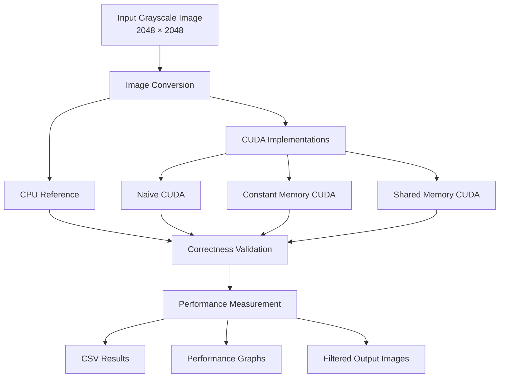
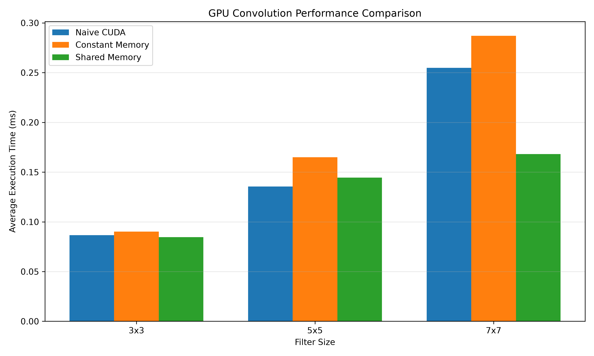
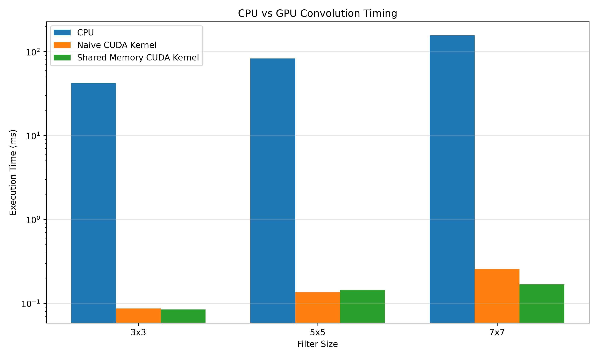
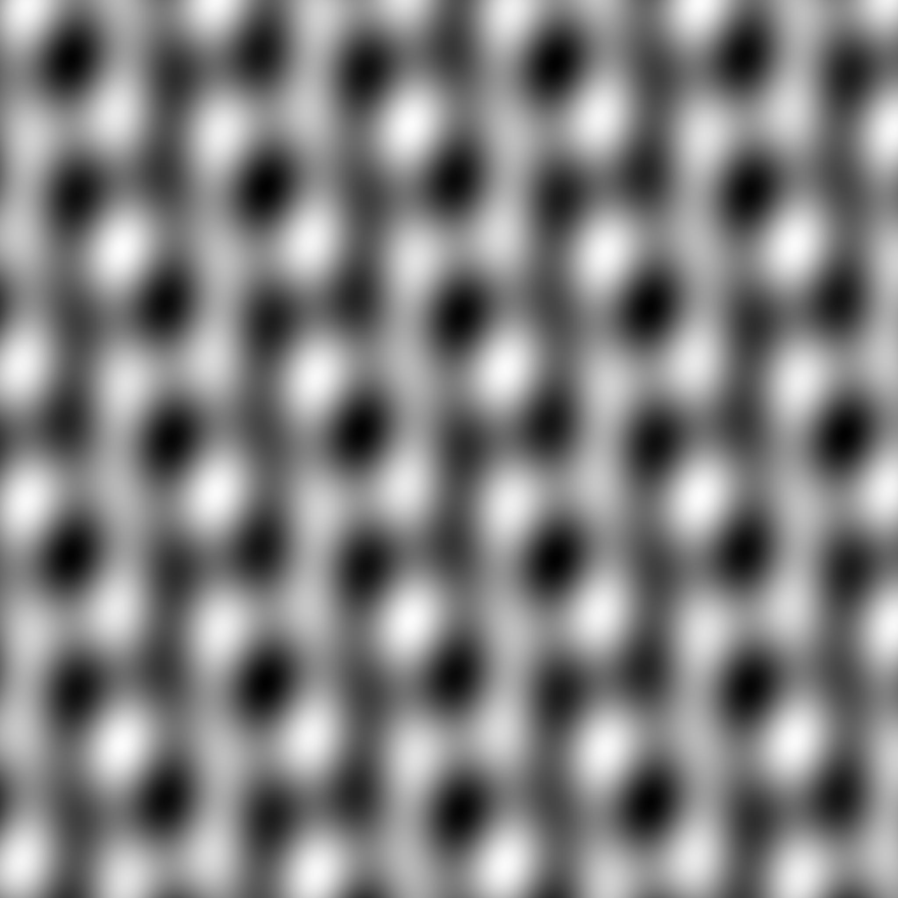
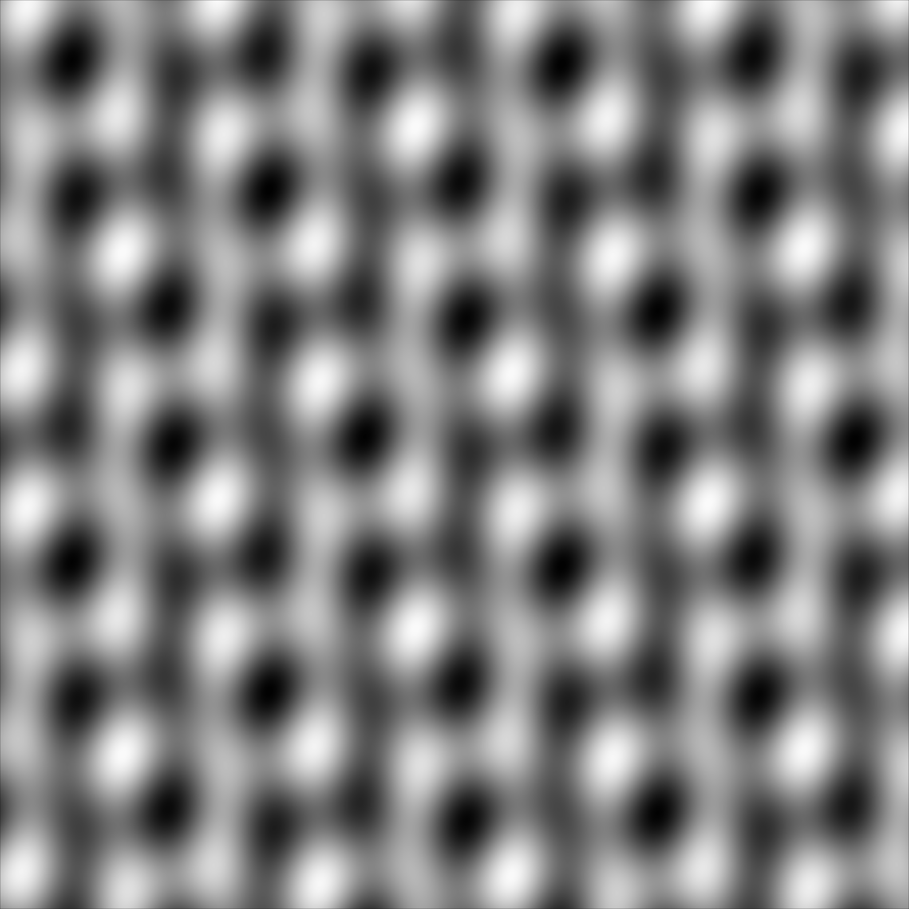
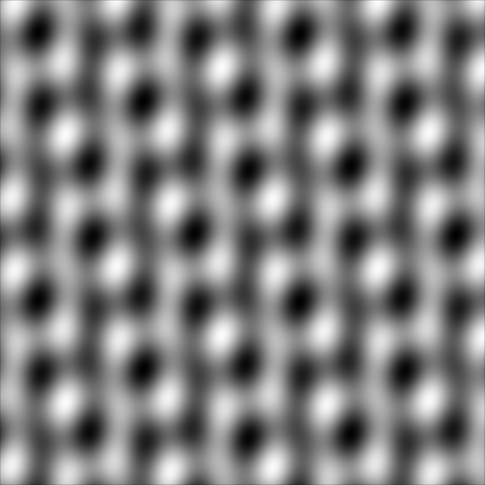
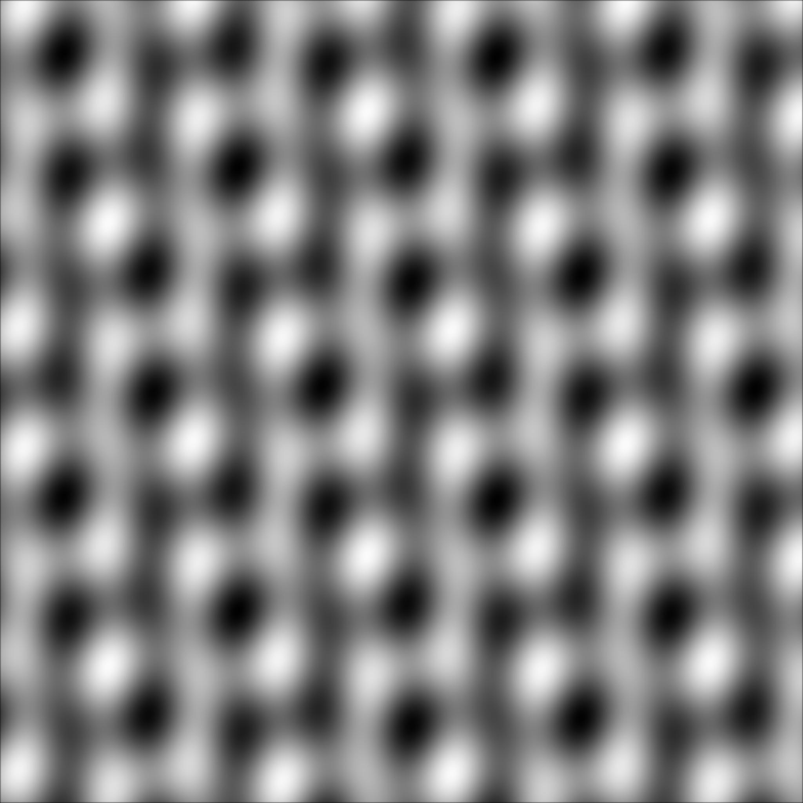
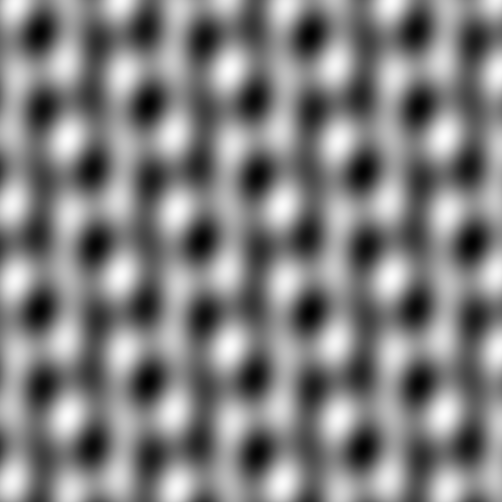
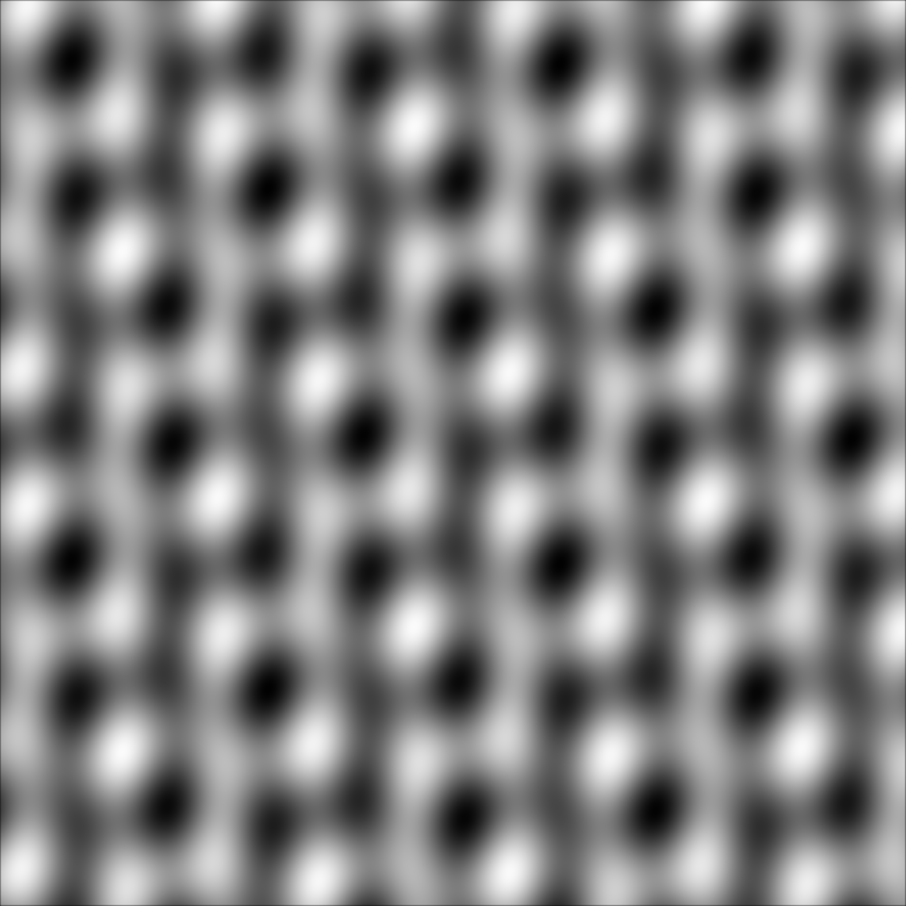

# 2D Convolution and Image Filtering Using CUDA

A Parallel Computing laboratory project implementing **2D image convolution on a 2048 × 2048 grayscale image** using CPU and NVIDIA CUDA GPU computing.

This project compares four implementations:

1. Sequential CPU convolution
2. Naive CUDA convolution using global memory
3. CUDA convolution using constant memory
4. CUDA convolution using shared memory tiling

The experiment evaluates execution time, memory optimization techniques, correctness, and performance for three convolution filter sizes: **3×3, 5×5 and 7×7**.

---

## Table of Contents

- [1. Problem Statement](#1-problem-statement)
- [2. Objectives](#2-objectives)
- [3. Components and Configuration](#3-components-and-configuration)
- [4. Problem Definition](#4-problem-definition)
- [5. System Architecture](#5-system-architecture)
- [6. Overall Execution Flow](#6-overall-execution-flow)
- [7. Part A - CPU Reference Convolution](#7-part-a---cpu-reference-convolution)
  - [7.1 Configuration](#71-configuration)
  - [7.2 Source Code](#72-source-code)
  - [7.3 Compilation and Execution](#73-compilation-and-execution)
- [8. Part B - Naive CUDA Convolution](#8-part-b---naive-cuda-convolution)
  - [8.1 CUDA Configuration](#81-cuda-configuration)
  - [8.2 Source Code](#82-source-code)
  - [8.3 Compilation and Execution](#83-compilation-and-execution)
- [9. Part C - Constant Memory CUDA Convolution](#9-part-c---constant-memory-cuda-convolution)
  - [9.1 Constant Memory Concept](#91-constant-memory-concept)
  - [9.2 Source Code](#92-source-code)
  - [9.3 Compilation and Execution](#93-compilation-and-execution)
- [10. Part D - Shared Memory CUDA Convolution](#10-part-d---shared-memory-cuda-convolution)
  - [10.1 Shared Memory and Tiling](#101-shared-memory-and-tiling)
  - [10.2 Halo Cells](#102-halo-cells)
  - [10.3 Source Code](#103-source-code)
  - [10.4 Compilation and Execution](#104-compilation-and-execution)
- [11. Correctness Validation](#11-correctness-validation)
- [12. Performance Results](#12-performance-results)
  - [12.1 Execution Time Comparison](#121-execution-time-comparison)
  - [12.2 Relative GPU Performance](#122-relative-gpu-performance)
  - [12.3 CPU and GPU Performance](#123-cpu-and-gpu-performance)
  - [12.4 Performance Graphs](#124-performance-graphs)
  - [12.5 Observations](#125-observations)
- [13. Output Images](#13-output-images)
- [14. Troubleshooting](#14-troubleshooting)
- [15. Industry Applications](#15-industry-applications)
- [16. Conclusion](#16-conclusion)
- [17. Author](#17-author)

---

# 1. Problem Statement

2D convolution is an important operation in image processing and computer vision. It is used to perform operations such as blurring, sharpening, edge detection, and feature extraction.

However, convolution requires multiple neighboring pixel accesses for every output pixel. As the filter size increases, the number of memory accesses and computational operations also increases.

For this experiment, a grayscale image of size **2048 × 2048** is processed using three convolution filters:

- 3×3 filter
- 5×5 filter
- 7×7 filter

The same convolution operation is implemented using four approaches:

1. Sequential CPU execution.
2. Naive CUDA using global memory.
3. Constant memory CUDA.
4. Shared memory CUDA with image tiling and halo cells.

The execution time of each implementation is measured and compared to understand how CUDA memory optimization techniques improve GPU performance.

---

# 2. Objectives

The objectives of this experiment are:

1. To understand the concept of 2D image convolution.
2. To implement image convolution using sequential CPU programming.
3. To implement parallel image convolution using CUDA.
4. To understand global memory access in a naive CUDA kernel.
5. To optimize filter coefficient access using constant memory.
6. To implement shared memory tiling for image data.
7. To understand halo or ghost cells and boundary handling.
8. To measure execution time using CUDA events.
9. To compare the performance of different CUDA implementations.
10. To validate GPU outputs against the CPU reference implementation.
11. To analyze how filter size affects execution time and speedup.

---

# 3. Components and Configuration

## 3.1 Hardware Requirements

| Component | Configuration |
|---|---|
| GPU | NVIDIA GeForce RTX 5060 Ti |
| GPU Memory | 16 GB |
| Image | 2048 × 2048 grayscale |
| Processor | Host CPU |
| System | Windows 10/11 |

## 3.2 Software Requirements

| Software | Purpose |
|---|---|
| Windows PowerShell | Command execution |
| CUDA Toolkit 13.4 | GPU programming |
| NVIDIA CUDA Compiler (`nvcc`) | CUDA compilation |
| C++ | CPU reference implementation |
| CUDA C++ | GPU implementations |
| Python 3.12 | Image conversion and analysis |
| NumPy | Numerical comparison |
| Pillow | Image processing |
| Matplotlib | Performance graphs |
| Visual Studio Build Tools | C++ compilation |
| Git | Version control |
| GitHub | Project repository |

## 3.3 CUDA Configuration

| Parameter | Value |
|---|---|
| Image Width | 2048 |
| Image Height | 2048 |
| Total Pixels | 4,194,304 |
| Block Size | 16 × 16 |
| Threads per Block | 256 |
| Grid Size | 128 × 128 |
| Total Blocks | 16,384 |
| Filter Sizes | 3×3, 5×5, 7×7 |

---

# 4. Problem Definition

The input image is a grayscale image represented as a two-dimensional matrix.

```text
Input Image = 2048 × 2048
```

The convolution operation applies a filter mask to the neighboring pixels of every image pixel.

For an output pixel:

```text
Output(x,y) = Σ Input(x+i,y+j) × Mask(i,j)
```

For this experiment, a normalized box filter is used.

Each filter coefficient has the value:

```text
Weight = 1 / (Mask Size × Mask Size)
```

### 3×3 Filter

```text
1/9   1/9   1/9
1/9   1/9   1/9
1/9   1/9   1/9
```

### 5×5 Filter

A 5×5 matrix containing 25 equal coefficients, each having a value of 1/25.

### 7×7 Filter

A 7×7 matrix containing 49 equal coefficients, each having a value of 1/49.

The output pixel is calculated by multiplying neighboring input pixels with the corresponding filter coefficients and summing the results.

### Boundary Handling

When the filter extends beyond the image boundary, out-of-bounds pixels are treated as zero.

The normalization factor remains based on the complete filter size.

---

# 5. System Architecture

The experiment uses four different implementations of the same convolution operation.



## 5.1 CPU Architecture

```text
          CPU
           |
      Input Image
           |
      Convolution
           |
      Filter Mask
           |
      Output Image
```

The CPU processes the image sequentially using nested loops.

## 5.2 Naive CUDA Architecture

```text
             CPU
              |
        Input Image
              |
       Global Memory
              |
          NVIDIA GPU
              |
       +------+------+
       |      |      |
     Block  Block  Block
       |      |      |
     Threads Threads Threads
       |      |      |
       +------+------+
              |
         Output Image
```

Each CUDA thread calculates one output pixel.

## 5.3 Constant Memory Architecture

```text
             CPU
              |
        Input Image
              |
       Global Memory
              |
       Filter Coefficients
              |
       Constant Memory
              |
          NVIDIA GPU
              |
        Convolution Kernel
              |
         Output Image
```

The filter coefficients are stored in CUDA constant memory.

## 5.4 Shared Memory Architecture

```text
             Global Memory
                   |
             Image Tiles
                   |
             Halo Loading
                   |
              Shared Memory
                   |
             Synchronization
                   |
            Convolution Kernel
                   |
              Output Image
```

Each CUDA block loads an image tile and its neighboring halo pixels into shared memory.

---

# 6. Overall Execution Flow

```text
        Input Image
             |
             v
       Image Conversion
             |
             v
       CPU Reference
             |
             v
       Naive CUDA Kernel
             |
             v
     Constant Memory Kernel
             |
             v
      Shared Memory Kernel
             |
             v
     Correctness Validation
             |
             v
     Performance Measurement
             |
             v
       CSV and Graphs
             |
             v
        Final Results
```

The same input image and filter sizes are used for all implementations to maintain a consistent mathematical workload.

---

# 7. Part A - CPU Reference Convolution

The CPU implementation provides the reference output for validating the GPU implementations.

## 7.1 Configuration

| Parameter | Value |
|---|---|
| Image Size | 2048 × 2048 |
| Execution Model | Sequential |
| Language | C++ |
| Filter Sizes | 3×3, 5×5, 7×7 |
| Timing | C++ high-resolution clock |

## 7.2 Source Code

The CPU source code is available in:

```text
src/cpu_reference.cpp
```

The implementation performs:

1. Input image loading.
2. Memory allocation for output pixels.
3. Sequential traversal of image pixels.
4. Application of the convolution mask.
5. Boundary checking.
6. Saving output in binary RAW format.
7. Execution-time measurement.

The CPU reference generates:

```text
output/cpu_3x3.raw
output/cpu_5x5.raw
output/cpu_7x7.raw
```

## 7.3 Compilation and Execution

Open PowerShell configured with Visual Studio C++ Build Tools.

Compile:

```powershell
cl /O2 /EHsc .\src\cpu_reference.cpp /Fe:cpu_reference.exe
```

Run:

```powershell
.\cpu_reference.exe
```

The generated CPU outputs are used for GPU correctness validation.

---

# 8. Part B - Naive CUDA Convolution

Naive CUDA implements image convolution using GPU parallelism and global memory.

## 8.1 CUDA Configuration

| Parameter | Value |
|---|---|
| Image Size | 2048 × 2048 |
| Block Size | 16 × 16 |
| Threads per Block | 256 |
| Grid Size | 128 × 128 |
| Memory | Global Memory |

Each CUDA thread calculates one output pixel.

Total logical threads:

```text
2048 × 2048 = 4,194,304
```

## 8.2 Source Code

The CUDA source code is available in:

```text
src/naive_convolution.cu
```

The implementation:

- Loads image data from global memory.
- Calculates the pixel coordinates using block and thread indices.
- Reads neighboring pixels according to the filter size.
- Performs convolution.
- Stores the result in global memory.

The kernel uses:

```cpp
int x = blockIdx.x * blockDim.x + threadIdx.x;
int y = blockIdx.y * blockDim.y + threadIdx.y;
```

Each thread is responsible for one output pixel.

### Limitation

Neighboring output pixels frequently require overlapping input pixels.

Therefore, multiple threads may read the same image data from global memory.

This creates repeated memory accesses.

## 8.3 Compilation and Execution

Compile:

```powershell
nvcc -arch=sm_120 .\src\naive_convolution.cu -o .\naive_convolution.exe
```

Run:

```powershell
.\naive_convolution.exe
```

Output files:

```text
output/naive_3x3.raw
output/naive_5x5.raw
output/naive_7x7.raw
```

---

# 9. Part C - Constant Memory CUDA Convolution

Constant memory is a read-only CUDA memory space designed for data that is accessed by many threads and remains unchanged during kernel execution.

## 9.1 Constant Memory Concept

The convolution filter coefficients are common to all CUDA threads.

Instead of repeatedly obtaining filter coefficients from global memory, they are stored in constant memory.

The implementation declares:

```cpp
__constant__ float d_mask[49];
```

The maximum filter size is 7×7, requiring 49 coefficients.

### Constant Cache Broadcast

When threads in a warp access the same constant memory address, the constant cache can broadcast that value to the participating threads.

This makes constant memory useful for shared read-only data such as convolution filter coefficients.

## 9.2 Source Code

The CUDA source code is available in:

```text
src/constant_memory.cu
```

The implementation:

1. Defines the filter in constant memory.
2. Calculates normalized filter coefficients.
3. Copies coefficients using `cudaMemcpyToSymbol()`.
4. Launches the CUDA convolution kernel.
5. Reads the filter coefficients from constant memory.
6. Stores the output image.

The filter coefficients are copied using:

```cpp
cudaMemcpyToSymbol(
    d_mask,
    mask.data(),
    mask.size() * sizeof(float)
);
```

The implementation uses:

```text
Global Memory  → Image Data
Constant Memory → Filter Coefficients
```

## 9.3 Compilation and Execution

Compile:

```powershell
nvcc -arch=sm_120 .\src\constant_memory.cu -o .\constant_memory.exe
```

Run:

```powershell
.\constant_memory.exe
```

Output files:

```text
output/constant_3x3.raw
output/constant_5x5.raw
output/constant_7x7.raw
```

---

# 10. Part D - Shared Memory CUDA Convolution

Shared memory is a fast on-chip memory space shared by threads within the same CUDA block.

It reduces repeated global memory accesses by allowing threads to reuse image pixels loaded into a shared tile.

## 10.1 Shared Memory and Tiling

The implementation uses:

```cpp
#define TILE_SIZE 16
#define MAX_RADIUS 3
#define SHARED_SIZE (TILE_SIZE + 2 * MAX_RADIUS)
```

Therefore:

```text
TILE_SIZE = 16
MAX_RADIUS = 3

SHARED_SIZE = 16 + 2(3)

SHARED_SIZE = 22
```

The shared memory tile is:

```text
22 × 22
```

Each block processes a 16×16 output tile while loading additional neighboring pixels.

### Why Tiling?

Without tiling, neighboring CUDA threads repeatedly access overlapping image regions from global memory.

With shared memory:

1. Each block loads an image tile.
2. Neighboring halo pixels are also loaded.
3. Threads synchronize.
4. Threads reuse the loaded data.
5. The convolution result is calculated.
6. Output pixels are written to global memory.

This reduces redundant global memory accesses.

## 10.2 Halo Cells

Halo cells are additional neighboring pixels loaded around the main image tile.

For a 7×7 filter:

```text
Radius = 7 / 2 = 3
```

Therefore, three neighboring pixels are required on each side.

```text
              Halo
        +------------------+
        |                  |
        |    +--------+    |
        |    |        |    |
        |    | 16×16  |    |
        |    |  TILE  |    |
        |    |        |    |
        |    +--------+    |
        |                  |
        +------------------+

       Halo width = 3 pixels
```

The halo allows threads to access neighboring pixels without repeatedly loading them from global memory.

### Boundary Handling

For pixels outside the image boundary, zero values are loaded into the shared tile.

This ensures that the convolution kernel does not access invalid image memory.

## 10.3 Source Code

The CUDA source code is available in:

```text
src/shared_memory.cu
```

The implementation:

- Allocates shared memory for the image tile.
- Loads central image pixels.
- Loads left and right halo pixels.
- Loads top and bottom halo pixels.
- Loads corner halo pixels.
- Synchronizes threads.
- Performs convolution using shared memory.
- Writes output pixels to global memory.

The shared memory declaration is:

```cpp
__shared__ unsigned char tile[SHARED_SIZE][SHARED_SIZE];
```

The implementation uses a 16×16 thread block and a shared tile of 22×22 pixels.

## 10.4 Compilation and Execution

Compile:

```powershell
nvcc -arch=sm_120 .\src\shared_memory.cu -o .\shared_memory.exe
```

Run:

```powershell
.\shared_memory.exe
```

Output files:

```text
output/shared_3x3.raw
output/shared_5x5.raw
output/shared_7x7.raw
```

---

# 11. Correctness Validation

Correctness validation ensures that all GPU implementations produce results matching the CPU reference.

The validation script compares:

- CPU reference output.
- Naive CUDA output.
- Constant memory CUDA output.
- Shared memory CUDA output.

The source script is:

```text
compare_results.py
```

It uses NumPy to calculate:

- Maximum absolute error.
- Mean absolute error.
- Number of mismatched pixels.

The error tolerance is:

```python
tolerance = 0.0002
```

A pixel is considered mismatched if its absolute difference from the CPU reference exceeds this tolerance.

### Validation Results

| Parameter | Result |
|---|---:|
| Filter Sizes | 3 |
| GPU Implementations | 3 |
| Total Comparisons | 9 |
| Failed Comparisons | 0 |
| Mismatched Pixels | 0 |
| Error Tolerance | 0.0002 |

**All nine GPU comparisons passed correctness validation.**

Run the validation:

```powershell
python .\compare_results.py
```

---

# 12. Performance Results

The performance analysis compares CPU execution time with the three GPU implementations.

CUDA events are used to measure GPU kernel execution time.

The performance analysis script is:

```text
performance_analysis.py
```

## 12.1 Execution Time Comparison

The following table shows the recorded average execution times.

All values are in milliseconds.

| Filter | CPU | Naive CUDA | Constant Memory | Shared Memory |
|---|---:|---:|---:|---:|
| 3×3 | 42.3285 | 0.0866 | 0.0901 | 0.0845 |
| 5×5 | 82.6065 | 0.1356 | 0.1650 | 0.1444 |
| 7×7 | 155.8290 | 0.2549 | 0.2870 | 0.1681 |

## 12.2 Relative GPU Performance

Naive CUDA is used as the baseline for comparing the GPU implementations.

Formula:

```text
Relative Performance =
Naive CUDA Time / Optimized CUDA Time
```

### Relative Performance Table

| Filter | Naive CUDA | Constant Memory | Shared Memory |
|---|---:|---:|---:|
| 3×3 | 1.00× | 0.96× | 1.02× |
| 5×5 | 1.00× | 0.82× | 0.94× |
| 7×7 | 1.00× | 0.89× | 1.52× |

The shared memory implementation achieves its largest relative improvement for the 7×7 filter.

## 12.3 CPU and GPU Performance

The following ratios compare CPU convolution time against GPU kernel execution time.

Formula:

```text
CPU / GPU Time Ratio =
CPU Execution Time / GPU Kernel Time
```

| Filter | Naive CUDA | Constant Memory | Shared Memory |
|---|---:|---:|---:|
| 3×3 | 488.78× | 469.62× | 500.79× |
| 5×5 | 609.19× | 500.59× | 571.95× |
| 7×7 | 611.33× | 542.96× | 926.81× |

**Measurement note:** CPU timings represent CPU convolution execution time, whereas GPU timings represent average kernel execution time. These are not end-to-end equivalent measurements because GPU data-transfer time is not included in the kernel timings. Therefore, these ratios should not be interpreted as complete application speedups.

## 12.4 Performance Graphs

### GPU Performance Comparison

The graph compares execution times of the three GPU implementations for all filter sizes.



### CPU vs GPU Performance Comparison

The graph compares CPU execution time with naive CUDA and shared memory CUDA execution times.

A logarithmic scale is used to make the differences easier to observe.



## 12.5 Observations

### 3×3 Filter

The three GPU implementations have similar execution times.

Shared memory is slightly faster than naive CUDA.

### 5×5 Filter

Execution time increases as the filter size increases.

Constant memory and shared memory do not outperform naive CUDA in this measurement.

### 7×7 Filter

The shared memory implementation provides the best GPU execution time.

The shared memory kernel achieves approximately 1.52× relative performance compared with naive CUDA.

This demonstrates the benefit of reusing neighboring image pixels through shared memory tiling for the larger filter.

### Overall Observation

The benefit of memory optimization depends on the filter size and memory access pattern.

Constant memory is useful for read-only filter coefficients, while shared memory is useful for reusing neighboring image data.

---

# 13. Output Images

The project generates grayscale input and filtered output images.

## 13.1 Input Image



## 13.2 Naive CUDA Outputs

### 3×3 Filter


### 5×5 Filter


### 7×7 Filter


## 13.3 Constant Memory Outputs

### 3×3 Filter



### 5×5 Filter



### 7×7 Filter



## 13.4 Shared Memory Outputs

### 3×3 Filter



### 5×5 Filter


### 7×7 Filter



---

# 14. Troubleshooting

| Problem | Solution |
|---|---|
| `nvcc` command not found | Verify CUDA Toolkit installation and PATH configuration. |
| CUDA compilation fails | Check CUDA Toolkit and Visual Studio compiler configuration. |
| GPU not detected | Run `nvidia-smi` and verify the NVIDIA driver. |
| Input image not found | Ensure `images/input.raw` exists. |
| Output file not generated | Check that the `output` directory exists. |
| Python module not found | Install NumPy, Pillow and Matplotlib. |
| Image conversion fails | Verify that RAW files contain the expected image dimensions and data type. |
| Incorrect output | Run the CPU/GPU correctness validation script. |
| Performance graphs not generated | Run `performance_analysis.py` from the project root directory. |

### Install Python Dependencies

```powershell
pip install numpy pillow matplotlib
```

---

# 15. Industry Applications

2D convolution is an important operation in image processing and computer vision.

Some real-world applications include:

1. **Image Filtering:** Applying blur, sharpening and smoothing filters to images.
2. **Edge Detection:** Identifying object boundaries and edges.
3. **Computer Vision:** Extracting useful image features.
4. **Medical Imaging:** Processing medical images such as X-rays and MRI scans.
5. **Convolutional Neural Networks (CNNs):** Performing convolution operations in neural network layers.
6. **Video Processing:** Applying image filters to video frames using GPU acceleration.

CUDA enables these operations to be executed in parallel on NVIDIA GPUs, improving processing performance for computationally intensive image-processing tasks.

---

# 16. Conclusion

This experiment successfully implemented 2D image convolution using CPU and NVIDIA CUDA GPU computing.

Four implementations were compared:

- Sequential CPU convolution.
- Naive CUDA using global memory.
- Constant memory CUDA.
- Shared memory CUDA with image tiling and halo cells.

The experiment processed a 2048 × 2048 grayscale image using 3×3, 5×5 and 7×7 convolution filters.

All three GPU implementations were validated against the CPU reference, with **zero failed comparisons and zero mismatched pixels across nine comparisons**.

The performance analysis showed that shared memory provides its greatest benefit for the 7×7 filter, achieving approximately 1.52× relative performance compared with naive CUDA.

The experiment demonstrates how CUDA parallel processing, constant memory, shared memory and data reuse can improve the performance of image convolution.

---

# 17. Author

**Krupa Akki**

CSE (Artificial Intelligence)  
K.L.E. Technological University, Hubli

---

## Repository Structure

```text
CUDA_Convolution_Project/
│
├── README.md
│
├── src/
│   ├── cpu_reference.cpp
│   ├── naive_convolution.cu
│   ├── constant_memory.cu
│   ├── shared_memory.cu
│   └── gpu_test.cu
│
├── images/
│   ├── input.png
│   └── input.raw
│
├── output/
│   ├── cpu_3x3.raw
│   ├── cpu_5x5.raw
│   ├── cpu_7x7.raw
│   ├── naive_3x3.png
│   ├── naive_5x5.png
│   ├── naive_7x7.png
│   ├── constant_3x3.png
│   ├── constant_5x5.png
│   ├── constant_7x7.png
│   ├── shared_3x3.png
│   ├── shared_5x5.png
│   └── shared_7x7.png
│
├── results/
│   ├── cpu_gpu_comparison.png
│   ├── gpu_performance_comparison.png
│   └── performance_results.csv
│
├── compare_results.py
├── convert_image.py
├── convert_outputs.py
├── generate_image.py
└── performance_analysis.py
```

## How to Run the Complete Project

Execute the following commands from the project root directory.

**1. Compile CPU reference**

```powershell
cl /O2 /EHsc .\src\cpu_reference.cpp /Fe:cpu_reference.exe
```

**2. Compile Naive CUDA**

```powershell
nvcc -arch=sm_120 .\src\naive_convolution.cu -o .\naive_convolution.exe
```

**3. Compile Constant Memory CUDA**

```powershell
nvcc -arch=sm_120 .\src\constant_memory.cu -o .\constant_memory.exe
```

**4. Compile Shared Memory CUDA**

```powershell
nvcc -arch=sm_120 .\src\shared_memory.cu -o .\shared_memory.exe
```

**5. Execute all implementations**

```powershell
.\cpu_reference.exe
.\naive_convolution.exe
.\constant_memory.exe
.\shared_memory.exe
```

**6. Validate correctness**

```powershell
python .\compare_results.py
```

**7. Generate output images**

```powershell
python .\convert_outputs.py
```

**8. Generate performance graphs and CSV**

```powershell
python .\performance_analysis.py
```

---

**Project Repository:** [PGC-LabEvaluation-2 – 2D Convolution and Image Filtering](https://github.com/Krupa1310/5th-sem-labs/tree/main/PGC-LabEvaluation-2-2D%20Convolution%20and%20Image%20Filtering)
